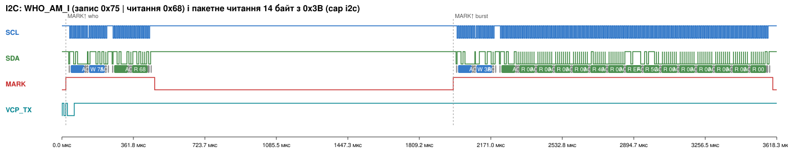
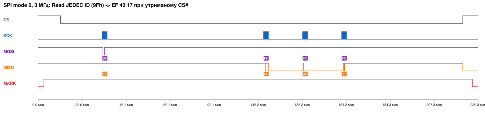
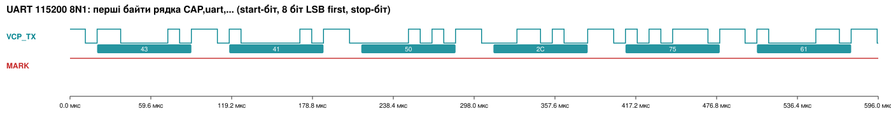

# Аналіз записів логічного аналізатора

Усі записи зроблено в Wokwi (компонент `wokwi-logic-analyzer`), кожен відтворюється однією командою:

```bash
make captures
```

Скрипт `tools/capture.py` для кожного запису генерує сценарій `<name>.scenario.yaml`. Сценарій чекає `READY`, надсилає в консоль команду (`mode hold`, потім `cap i2c|spi|pwm|uart|anomaly`) і чекає `CAP,<x>,END`. Команда `cap ...` у прошивці (`App/app.c`) ініціює саме ту транзакцію, яку записуємо, і обрамлює кожну подію фронтами службового виводу **MARK (PA9)**. Числові вимірювання — у [`measurements.md`](measurements.md) (генерує `tools/analyze_captures.py`), анотації sigrok-cli — у `*.txt` поруч із записами.

## Параметри запису

| Файл | Канали D0…D7 | Частота дискретизації | Тригер | Що робила прошивка |
|---|---|---|---|---|
| `i2c-mpu6050-whoami-burst.vcd` | SCL, SDA, MARK, VCP_TX | VCD з роздільністю 1 нс; декодування з `downsample=50` → 20 MS/s (50 вибірок на біт I²C) | без тригера (запис від старту), транзакції знаходимо за фронтами MARK | `cap i2c`: WHO_AM_I, потім пакетне читання 14 байт з 0x3B |
| `spi-w25q64-jedec-wren-program-read.vcd` | SCK, MOSI, MISO, CS, MARK, VCP_TX | `downsample=10` → 100 MS/s (33 вибірки на біт SCK) | те саме | `cap spi`: 9Fh; WREN → 05h → 02h + 16 байт → опитування BUSY; 03h + 16 байт |
| `pwm-servo-pan-tilt-3-angles.vcd` | PWM_PAN, PWM_TILT, MARK, VCP_TX | `downsample=1000` → 1 MS/s (роздільність 1 мкс = 1 тік TIM3) | те саме | `cap pwm`: pan 0/90/180°, tilt 45/90/135°, по 100 мс |
| `uart-vcp-and-ft232rl.vcd` | VCP_TX, VCP_RX, FT_RXD, FT_TXD, MARK | `downsample=100` → 10 MS/s (87 вибірок на біт) | те саме | `cap uart`: рядок у USART2 і USART1 (FT232RL) |
| `i2c-anomaly-nack-restart-hang.vcd` | SCL, SDA, MARK, VCP_TX | 20 MS/s | те саме | `cap anomaly`: адреса 0x69, `HAL_I2C_Mem_Read`, відновлення |
| `i2c-anomaly-hal-build-on-wokwi.vcd` | SCL, SDA, MARK, VCP_TX | 20 MS/s | — | прошивка `BOARD_TARGET=nucleo` у симуляторі |
| `boot-selftest-all-buses.vcd` | SCL, SDA, SCK, MOSI, MISO, CS, PWM_PAN, MARK | 20 MS/s | — | самоперевірка на старті |
| `i2c-reference-timingr-100k-lr1-firmware.vcd` | SCL, SDA, UART_TX, BTN | 1 нс | — | прошивка ЛР1 (TIMINGR для 100 кГц) — контроль для A4 |

**Частота дискретизації.** Для надійного декодування потрібно щонайменше 4 вибірки на найкоротший інтервал сигналу (Найквіст дає 2, але фронт може потрапити між вибірками). Практично беруть 8–10.

| Шина | Найкоротший інтервал | Мінімальна частота дискретизації |
|---|---|---|
| I²C 400 кГц | tHIGH ≈ 0.6 мкс | ≥ 7–13 MS/s |
| SPI 3 МГц | напівперіод 167 нс | ≥ 24 MS/s |
| UART 115200 | біт 8.7 мкс | ≥ 1 MS/s |
| PWM | роздільність 1 мкс | 1 MS/s |

Wokwi пише моменти змін з роздільністю 1 нс, тобто обмеження немає. У реального аналізатора fx2lafw межа 24 MS/s, що для SPI 3 МГц дає рівно 8 вибірок на біт. Тому SCK і не піднято вище: SPI 24 МГц таким аналізатором вже не декодувати.

**Тригер.** Природні тригери:
- I²C — спад SDA при SCL = 1 (START);
- SPI — спад CS#;
- UART — спад лінії (старт-біт);
- PWM — фронт каналу.

У наших записах роль тригера виконує MARK: це фронт, який прошивка виставляє безпосередньо перед зверненням до шини. Він однаковий для всіх інтерфейсів і прив'язує запис до події в коді (атрибут `triggerMode=edge, triggerPin=D7` аналізатора Wokwi дає те саме апаратно).

**Глибина запису.** Wokwi зберігає лише зміни рівня (9 байт на зміну, буфер 2 000 000 змін ≈ 18 МБ). Реальний аналізатор з 8 каналами пише 1 байт на вибірку: 1 с при 24 MS/s = 24 МБ. Тому для довгих записів знижують частоту або вмикають тригер.

**Спільна земля.** Логічний аналізатор вимірює напругу щупа відносно своєї GND. Без з'єднання з GND стенда опорний рівень «плаває»: наводки й ємнісні зв'язки дають фантомні фронти, а справжні рівні можуть не перетинати поріг. Щось «видно», але цьому не можна вірити.

---

## 1. I²C — MPU-6050



**Декодована послідовність** (`i2c-mpu6050-whoami-burst.i2c.txt`, вікно команди `cap i2c`):

```
S  68 W ACK  75 ACK  P                               ← номер регістра WHO_AM_I
S  68 R ACK  68 NACK P                               ← відповідь 0x68
S  68 W ACK  3B ACK  P                               ← ACCEL_XOUT_H
S  68 R ACK  00 00 | 00 00 | 40 00 | EF 5C | 00 00 | 00 00 | 00 00 NACK P
             ACC_X   ACC_Y   ACC_Z   TEMP    GYRO_X  GYRO_Y  GYRO_Z
```

**Зіставлення з datasheet.**
- Адреса b1101000 = 0x68 при AD0 = 0 ([PS] §9.2 p.36).
- WHO_AM_I = 0x68 ([RMAP] p.46).
- Пакетне читання з автоінкрементом 0x3B…0x48 відповідає [PS] §9.3 p.37 («Burst Read Sequence»). Майстер підтверджує кожен байт ACK, останній — NACK, після чого STOP. Так і має бути за [I2C] §3.1.6.
- **Відмінність від datasheet:** між записом номера регістра і читанням стоїть **STOP + START**, а не repeated START (Sr), як на діаграмі [PS] p.37. Причина — аномалія A2: у симуляторі Sr не працює. MPU-6050 зберігає вказівник регістра між транзакціями, тому дані ті самі.
- Фізична правдоподібність: Z = 0x4000 = 16384 LSB = **1.000 g** при ±2 g ([PS] §6.2 p.13), X = Y = 0. Модуль вектора — 1000 mg (допуск ±110 mg). TEMP = 0xEF5C = −4260 → −4260/340 + 36.53 = **24.00 °C** ([RMAP] p.31), що збігається з температурою моделі Wokwi.
- Ці байти — тестовий вектор `tests/vectors/capture_vectors.h`. Тест `test_capture_vector_matches_uart_log` перевіряє, що драйвер дає з них ті самі значення, що прошивка надрукувала в UART (`CAP,i2c,acc_mg=0/0/1000,temp_cdeg=2400`).

**Часові параметри** (детально — `measurements.md`):

| Параметр | Виміряно | Очікувалось | Висновок |
|---|---|---|---|
| fSCL | 99.7 кГц (період 10.0 мкс) | 400 кГц за TIMINGR 0x50330309 | розбіжність, аномалія A4 |
| tLOW / tHIGH | 5.0 / 5.0 мкс | 1.25 / 0.5 мкс + tSYNC | модель Wokwi завжди дає меандр 5/5 мкс |
| tHD;STA, tSU;STO | 5.0 мкс | ≥ 0.6 мкс (Fm), ≥ 4.0 мкс (Sm) | вимоги I²C виконуються навіть для Standard-mode |
| tBUF (STOP → START) | 21.8 мкс | ≥ 1.3 мкс | OK; це час повернення з `i2c_write` і входу в `HAL_I2C_Master_Receive` |
| MARK↑ → START | 14.3 мкс | — | затримка «подія в прошивці → шина»: виклик через `i2c_bus_t`, скидання PE, запис CR2 |
| WHO_AM_I (2 транзакції) | 449.6 мкс | 36 біт × 10 мкс = 360 мкс + накладні | накладні ≈ 90 мкс на два виклики HAL |
| Пакетне читання | 1617.3 мкс | 153 біти × 10 мкс = 1530 мкс | накладні ≈ 87 мкс; на залізі при 400 кГц ≈ 0.4 мс |

### Ручне декодування (без декодера)


Перша транзакція команди `cap i2c`; рівень SDA зчитується на кожному **фронті SCL**:

1. **START:** SDA падає 1 → 0, поки SCL = 1 (чорна мітка «S»).
2. **Біти адреси, MSB first:** 1, 1, 0, 1, 0, 0, 0 → b1101000 = **0x68**.
3. **8-й біт R/W:** 0 → **запис**.
4. **9-й такт — ACK:** майстер відпускає SDA, MPU-6050 тягне її в 0 (червона мітка «0»). Це ACK, тобто пристрій з такою адресою є.
5. **Байт даних:** 0, 1, 1, 1, 0, 1, 0, 1 → b01110101 = **0x75** (WHO_AM_I), далі ACK = 0.
6. **STOP:** SDA піднімається 0 → 1, поки SCL = 1.

Результат збігається з рядком `Address write: 68, Data write: 75` декодера sigrok.

## 2. SPI — W25Q64JV




**Декодовані транзакції** (`*.spi-transfer.txt`; в одному рядку — один інтервал CS# = 0, формат «MOSI / MISO»):

```
9F FF FF FF            / FF EF 40 17   ← Read JEDEC ID: Winbond, 64 Mbit
06                     / FF            ← Write Enable
05 FF                  / FF 02         ← SR1 = 02h: WEL=1, BUSY=0
02 7F F1 00 A5 CA … D0 / FF … FF       ← Page Program, адреса 7FF100h, 16 байт
05 FF                  / FF 03         ← SR1 = 03h: BUSY=1, WEL=1 (програмування триває)
05 FF / FF 03, 05 FF / FF 03           ← ще два опитування BUSY
05 FF                  / FF 00         ← BUSY=0, WEL=0: операцію завершено
03 7F F1 00 FF …       / FF FF FF FF A5 CA … D0   ← Read Data: прочитане = записане
```

**Зіставлення з datasheet [W25].**
- JEDEC ID = EF 40 17 (p.21).
- WREN передує 02h і встановлює WEL (§8.2 p.24). Драйвер додатково перевіряє WEL через 05h і без нього 02h не надсилає (тест `test_page_program_without_wel_is_aborted`).
- Під час програмування BUSY = 1, а WEL тримається до завершення і скидається разом з BUSY (§7.1, p.13).
- /CS піднімається після 8-го біта останнього байта (p.35).
- Дані читання побайтно збігаються з записаними: `CAP,spi,read=A5CAEF14395E83A8CDF2173C6186ABD0`.
- **Підтвердження mode 0** за записом. CPOL = 0: на кожному спаді й фронті CS# SCK = 0. Перевірено скриптом на 12 транзакціях: рівень SCK у ці моменти завжди 0, як у [W25] p.11 («CLK normally low on the falling and rising edges of /CS» для Mode 0). CPHA = 0: флеш захоплює DI на **фронті** SCK, і всі 4 байти команди декодуються однаково на фронті. Фазу даних модель ідеалізує: MOSI змінюється в той самий момент, що й фронт SCK (вимір: 0 нс до фронту, 150–175 нс після спаду), тобто setup дорівнює 0 — див. аномалію A6.

| Параметр | Виміряно | Розрахунок / вимога |
|---|---|---|
| fSCK | 2.979 МГц (період 336 нс) | 48 МГц / 16 = 3 МГц (різниця 0.7 % — квантування фронтів моделі) |
| Проміжок між байтами в транзакції | 23.7 мкс середній, min 4.35 мкс | — polling HAL: TXE/RXNE на кожен байт; на залізі теж буде, але менше |
| MARK↑ → CS#↓ | 8.7 мкс | — |
| Page Program (WREN … BUSY = 0) | 1.338 мс, 7 транзакцій, 4 опитування BUSY | tPP typ 0.4 мс / max 3 мс (§9.6 p.64); модель використовує typ 0.4 мс; решта — накладні SPI |

**Дефект, знайдений порівнянням з записом.** У першій версії фаза читання надсилала на MOSI вміст буфера приймача (0x00), а не 0xFF. Причина: `HAL_SPI_Receive` у режимі full-duplex master передає `pData` як TX. Тест `test_probe_matches_capture` порівнює транзакцію драйвера з байтами на шині й показав цю розбіжність. Виправлення — явні dummy 0xFF у `Platform/platform.c` (коміт `c816378`).

## 3. PWM — SG92R ×2


| Крок | pan: задано → виміряно | tilt: задано → виміряно | Період |
|---|---|---|---|
| 1 | 0° → 544 мкс → **544.000 мкс** | 45° → 1008 мкс → **1008.000 мкс** | 20.000 мс |
| 2 | 90° → 1472 мкс → **1472.000 мкс** | 90° → 1472 мкс → **1472.000 мкс** | 20.000 мс |
| 3 | 180° → 2400 мкс → **2400.000 мкс** | 135° → 1936 мкс → **1936.000 / 1936.025 мкс** | 20.000 мс |

Ширина = CCR × 1 мкс. Розрахунок: 544 + deg × (2400 − 544)/180, з округленням (`servo_pulse_for_deg`). Період = (ARR + 1) × (PSC + 1) / 48 МГц = 20 000 × 48 / 48 МГц = 20 мс. Похибка 25 нс в одному імпульсі — це квантування часу моделі, менше за dead band SG92R (1 мкс, [SG]). Нове значення CCR набирає чинності з наступного періоду: увімкнено preload (ARPE/OCxPE), тож «рваного» імпульсу немає. Перший період після MARK виключено з вимірювання саме тому.

## 4. UART — ST-LINK VCP і FT232RL



**Декодовано** (`uart-vcp-and-ft232rl.uart-FT_RXD.txt`, лінія PB6 → FT232RL RXD):

```
43 41 50 2C 75 61 72 74 2C 61 75 78 5F 70 61 79 6C 6F 61 64 3D 4C 52 32 2D 46 54 32 33 32 52 4C 2D 30 31 32 33 34 35 36 37 38 39 0D 0A
 C  A  P  ,  u  a  r  t  ,  a  u  x  _  p  a  y  l  o  a  d  =  L  R  2  -  F  T  2  3  2  R  L  -  0  1  2  3  4  5  6  7  8  9 \r \n
```

Модель FT232RL отримала той самий рядок і вивела його в консоль чипів (`[chip-ft232rl] FT232RL> CAP,uart,aux_payload=...`). Лінія VCP_TX декодується так само (`CAP,uart,payload=LR2-UART-0123456789`).

| Параметр | Виміряно | Розрахунок |
|---|---|---|
| Тривалість біта VCP_TX | 8.688 мкс → 115 097 бод | BRR = 417 → 48·10⁶/417 = 115 108 бод (−0.08 % від 115 200) |
| Тривалість біта FT_RXD | 8.688 мкс → 115 098 бод | те саме |

Формат 8N1 на осцилограмі: старт-біт 0, 8 біт даних **LSB first**, стоп-біт 1. Наприклад, 0x43 «C» = 1 1 0 0 0 0 1 0 у порядку передачі. Похибка 0.08 % значно менша за допуск приймача, який має порядок ±2–3 % ([RM] Tables 129/130).

## 5. ADC

АЦП у продукті (тема 6, PRD) не використовується: усі датчики цифрові. Методичка пропонує фіксувати момент вимірювання АЦП службовим GPIO; для цього вже заведено MARK (PA9). Якщо в майбутньому з'явиться аналоговий датчик, MARK виставлятиметься перед `HAL_ADC_Start` і скидатиметься після EOC, а різниця фронтів дасть час перетворення.

---

## 6. Аномалії


### A1. NACK на неіснуючу адресу (створено свідомо)
`cap anomaly`, крок 1: `S 69 W NACK P`. MPU-6050 має AD0 = 0, тому на 0x69 ніхто не тягне SDA в 9-му такті, і лінія лишається високою (NACK). Контролер генерує STOP (AUTOEND), HAL повертає `HAL_I2C_ERROR_AF`, Platform перекладає це в `DEV_ERR_NACK`. UART: `step=wrong_addr,addr=0x69,st=NACK`. HAL і шина узгоджені.

### A2. `HAL_I2C_Mem_Read` (repeated START) зависає — розбіжність HAL ↔ шина
Крок 2: на шині `S 68 W ACK 75 ACK`, і далі **нічого**: ні Sr, ні STOP, SCL у високому стані. `HAL_I2C_Mem_Read` чекає 5 мс і повертає TIMEOUT (`step=mem_read_restart,val=0x00,st=TIMEOUT`). Регістровий експеримент показав: після байта TC = 1 (ISR = 0x8043), але запис CR2.START для restart модель Wokwi ігнорує, а BUSY лишається 1. Наступне читання без відновлення одразу повертає `st=BUS`, бо шина зайнята, і на шині нічого не з'являється. Після `HAL_I2C_DeInit/Init` (скидання PE, [RM] §25.4) читання знову працює: `val=0x68,st=OK`.

Цікава деталь запису: перший START після відновлення декодер sigrok позначає як **«Start repeat»**, бо попередня транзакція так і не завершилась STOP. Це саме той «неочікуваний повторний START», про який пише методичка, і він видимий лише на шині, а не в лозі.

**Рішення:** для `BOARD_TARGET=wokwi` Platform виконує запис номера регістра і читання як дві транзакції (STOP + START). Для реальної плати лишається `HAL_I2C_Mem_Read` (`BOARD_TARGET=nucleo`).

### A3. `HAL_I2C_Master_Transmit` передає лише перший байт — розбіжність HAL ↔ шина
Запис `i2c-anomaly-hal-build-on-wokwi`: прошивка з HAL-шляхом у симуляторі дає `ST,dev=MPU6050,res=FAIL,...,err=TIMEOUT`. На шині лише `S 68 W ACK 75 ACK` і зупинка. Причина: HAL C0 v1.4.1 завантажує перший байт у TXDR ще **до** START (`stm32c0xx_hal_i2c.c:1166`, «Preload TX register»), а модель після цього не виставляє TXIS для другого байта. Крім того, після читання модель лишає TXIS = 1 у стані спокою (ISR = 0x00000003), і будь-який запис у TXDR до адресної фази має той самий ефект. Рішення в Platform: перед транзакцією скинути прапорці контролера (PE = 0 → 1), далі писати TXDR лише по TXIS. Після цього вся ініціалізація MPU-6050 видна на шині: `68 W 6B 80`, `6B 01`, `1A 03`, `19 04`, `1B 00`, `1C 00`, контрольне читання `6B → 01`.

### A4. Модель I²C ігнорує TIMINGR
За TIMINGR = 0x50330309 (Fm, 400 кГц) очікувалось tSCL ≈ 2.5 мкс. Виміряно 10.0 мкс, tLOW = tHIGH = 5.0 мкс. Контрольний запис з прошивкою ЛР1 (TIMINGR = 0xB0420F13, 100 кГц) дає ті самі 5.0/5.0 мкс, хоча на реальному МК було б 5.0/4.0 мкс + tSYNC ([RM] Table 115). Тобто частоту I²C у симуляторі перевірити неможливо. На залізі вимір — Saleae ≥ 4 MS/s, критерій tLOW ≥ 1.3 мкс і tHIGH ≥ 0.6 мкс ([RM] Table 112).

### A5. Невизначений MISO під час фази команди
У самоперевірці на старті перший байт MISO під час 9Fh декодується як 0x7F, а в команді `cap spi` — як 0xFF. За datasheet DO під час команди у високоімпедансному стані (§8.1), тож значення не визначене: модель починає драйвити MISO із запізненням на перший біт після спаду CS#. Драйвер ці байти ігнорує (читає відповідь лише після заголовка), тому на результат це не впливає. На реальному стенді лінію MISO «тримає» лише ємність, і там теж можна побачити довільні біти.

### A6. Ідеалізована фаза даних SPI у моделі
На реальному STM32 у режимі CPHA = 0 майстер змінює MOSI на **спаді** SCK, і до фронту є півперіоду setup (≈ 167 нс при 3 МГц; вимога флеш tDVCH ≥ 1 нс, [W25] §9.6 p.63). У VCD Wokwi кожна зміна MOSI збігається з фронтом SCK з точністю 0 нс: 40 з 40 змін, `tools/analyze_captures.py` / перевірка в журналі. Декодер sigrok все одно отримує правильні байти, бо обробляє події з однаковою міткою часу в порядку запису. Але перевірити запас часу setup/hold у симуляторі неможливо. На залізі: записати SCK/MOSI з частотою ≥ 24 MS/s і переконатися, що MOSI змінюється біля спаду SCK.
