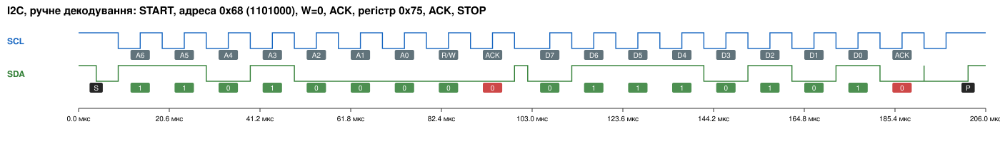
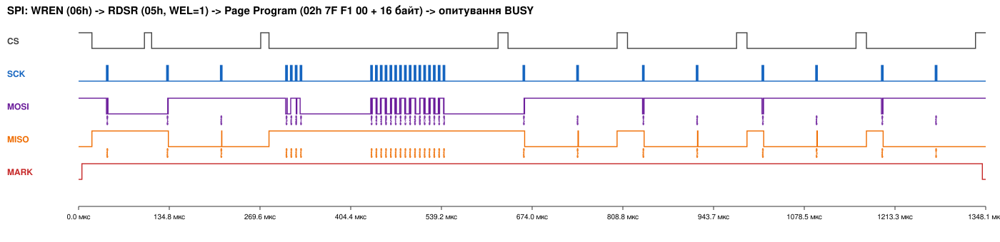
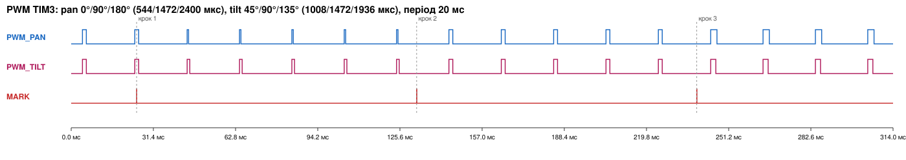
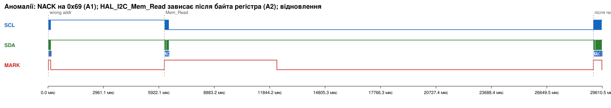
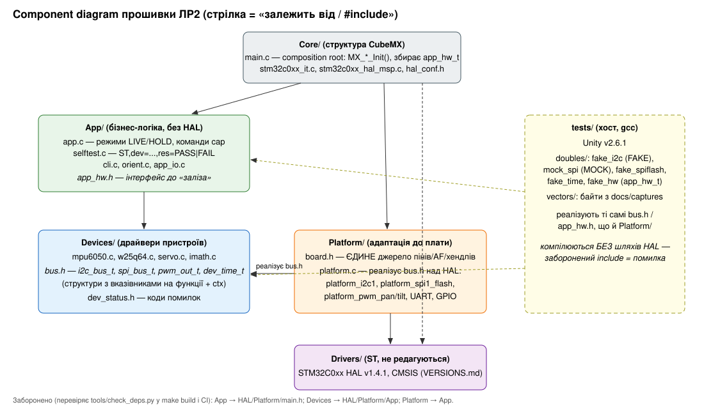

<div class="title-page">

<p class="center">МІНІСТЕРСТВО ОСВІТИ І НАУКИ УКРАЇНИ<br>
НАЦІОНАЛЬНИЙ ТЕХНІЧНИЙ УНІВЕРСИТЕТ УКРАЇНИ<br>
«КИЇВСЬКИЙ ПОЛІТЕХНІЧНИЙ ІНСТИТУТ імені ІГОРЯ СІКОРСЬКОГО»<br>
Кафедра обчислювальної техніки</p>

<br><br><br>

<p class="center"><b>ЗВІТ</b><br>
з лабораторної роботи №2<br>
з дисципліни «Системне програмування вбудованих систем»</p>

<p class="center"><b>«Інтеграція сенсорної підсистеми: схема підключення, верифікація інтерфейсів логічним аналізатором, архітектура програмного проєкту»</b></p>

<p class="center">Тема проєкту: Motion-Mirroring Teleoperator (№6, Додаток A)<br>Форма виконання: B (Wokwi), індивідуально</p>

<br><br><br>

<p class="right">Виконав:<br>студент групи ІО-31<br><b>Сас Євгеній Олегович</b></p>

<p class="right">Перевірив:<br>Гордієнко Нікіта Юрійович</p>

<br><br>

<p class="center">Київ — 2026</p>

</div>

<div class="page-break"></div>

## Зміст

1. Мета
2. Завдання
3. Виконання
   - 3.1 Конфігурація стенда і відхилення від методички
   - 3.2 Аргументація архітектурних рішень (схема підключення)
   - 3.3 Інструкція з підключення
   - 3.4 Підключення і перевірка всіх пристроїв (самоперевірка)
   - 3.5 Записи логічного аналізатора і їх аналіз
   - 3.6 Структура проєкту, бібліотеки, правила залежностей
   - 3.7 Тестування
   - 3.8 CI
   - 3.9 Журнал проблем
   - 3.10 Внесок за напрямами
   - 3.11 Відеозвіт
4. Висновки
5. Відповіді на контрольні питання
6. Джерела

## 1. Мета

Довести, що вся апаратна частина продукту Motion-Mirroring Teleoperator сумісна фізично і логічно:
- усі пристрої з PRD працюють одночасно в одній прошивці;
- піни й периферійні блоки не конфліктують;
- кожна шина працює так, як описано в документації, і це підтверджено не лише логом в UART, а й незалежним вимірюванням сигналів логічним аналізатором.

Паралельно треба було побудувати фундамент для ЛР3–ЛР6: шарову структуру прошивки, автоматичну перевірку правил залежностей, хостові тести з покриттям і CI. Наступні роботи не повинні вимагати ні перемонтажу стенда, ні переписування каталогів.

## 2. Завдання

Відповідно до розділу 4 методички:

1. **4.1.** Pinout-таблиця «пін МК → функція → пристрій» з обґрунтуванням кожного рядка, таблиця адрес і ідентифікаторів, бюджет живлення, параметри шин з розрахунком від дерева тактування, схема і щонайменше два відхилені варіанти розкладки.
2. **4.2.** Для кожного пристрою з PRD: ідентифікація чіпа, мінімальна ініціалізація, перевірка фізичної правдоподібності даних. Усе — в одній прошивці з режимом самоперевірки, вивід якого придатний для автоматичного розбору.
3. **4.3.** Відтворювані записи логічного аналізатора для кожного інтерфейсу продукту (I²C, SPI, UART, PWM; ADC — спосіб фіксації) з параметрами запису.
4. **4.4.** Декодування в текст, зіставлення з datasheet, вимірювання часових параметрів і порівняння з розрахунком, ручне декодування кількох байтів, аналіз аномалій.
5. **4.5.** Шарова архітектура; лише потрібні модулі HAL; зафіксовані версії бібліотек; збірка без попереджень з `-Wall -Wextra`; автоматична перевірка правил залежностей; component diagram.
6. **4.6.** `make test` на хості; тести перетворень одиниць, обробки помилок шини, послідовності команд SPI-flash; тестові вектори з реальних записів; приклад розрахунку з datasheet; покриття; CI на кожен PR.

## 3. Виконання

### 3.1 Конфігурація стенда і відхилення від методички

| Елемент | За методичкою / PRD | Фактично | Пояснення |
|---|---|---|---|
| Плата | NUCLEO-F446RE / F411RE (Додаток A, документи DS10693/RM0390/UM1724) | **NUCLEO-C031C6** (STM32C031C6T6, Cortex-M0+, 48 МГц, 32 КБ Flash, 12 КБ RAM) | Wokwi симулює лише STM32C031, STM32L031, STM32F103; єдина Nucleo-64 — C031C6. Усі посилання — на DS13867, RM0490, UM2953 |
| MPU-6050 | I²C | `wokwi-mpu6050` | вбудована модель Wokwi |
| W25Q64 | SPI | **custom chip** `chips/w25q64/` | у Wokwi немає SPI-флеш; модель написана за datasheet W25Q64JV Rev J (доповнення, а не заміна) |
| SG92R ×2 | PWM | `wokwi-servo` ×2 | — |
| FT232RL | UART | **custom chip** `chips/ft232rl/` | у Wokwi немає; модель TTL-боку: приймає UART і показує рядок «як у терміналі ПК» |
| LED ×2, B1 | GPIO | `wokwi-led` + 330 Ω, `wokwi-pushbutton` на PC13 | B1 на платі моделі не активний — кнопка намальована окремо на тому ж піні |
| Логічний аналізатор | wokwi-logic-analyzer → VCD → PulseView | так само; декодування `sigrok-cli` (той самий рушій libsigrokdecode, методичка §3.3) | — |
| Камера | лише форма A | немає | тема 6 камери не містить |

Повна таблиця компонентів — [`docs/hardware-components.md`](hardware-components.md).

### 3.2 Аргументація архітектурних рішень (схема підключення)

Повний документ — [`docs/pinout.md`](pinout.md): 16 рядків таблиці пінів з номерами AF, роз'ємами Arduino/morpho, рівнями, pull-up і джерелами; адреси; бюджет живлення; розрахунки шин; схема; аналіз конфліктів; 5 відхилених варіантів. Ключові рішення:

- **Чому I²C на PB8/PB9 (D15/D14).** Це I2C1_SCL/SDA з AF6 ([DS] Table 15 p.36), піни FT_f, які підтримують Fast-mode і Fm+ ([DS] Table 12 p.34, §5.3.18 p.76). Вони стоять на стандартних місцях Arduino для I²C ([UM] Table 11 p.20). PB6/PB7 теж мають I2C1, але це Arduino D1/D0 = USART1 — природне місце для FT232RL (відхилений варіант V3).
- **Чому така частота I²C.** FR-01 PRD вимагає читати 14 байт IMU з частотою 200 Гц. При 400 кГц пакет триває ≈ 0.38 мс (8 % часу шини), при 100 кГц — 1.53 мс. TIMINGR = 0x50330309 узято з [RM] Table 115 p.711 для I2CCLK = 48 МГц. Обмеження з [DS] Table 60 (I2CCLK ≥ 9 МГц для Fm) виконується.
- **Чому SCK на PB3, а не на «стандартному» PA5 (D13).** PA5 через SB26 керує світлодіодом LD4 ([UM] Table 10 p.18), тож такт SPI блимав би LED. PB3 має SPI1_SCK на AF0 ([DS] Table 15) і стоїть на D3.
- **Чому CS# на PB0 (D10) і програмний.** D10 — традиційний CS для Arduino-шилдів ([UM] Table 11). Апаратний NSS піднімає лінію після кожного кадру, а W25Q64 потребує утримувати CS# усю команду: 4 байти заголовка плюс до 256 байт даних ([W25] p.35). Це гарантує лише програмне керування.
- **Чому 3 МГц SPI.** Межа C031 — 24 МГц ([DS] Table 62), межа флеш для 03h — 50 МГц. Але аналізатор fx2lafw має 24 MS/s, і для ≥ 8 вибірок на біт SCK не може перевищувати 3 МГц.
- **Чому обидва серво на TIM3 (PB4/PB5).** Однаковий період 50 Гц робить спільні PSC/ARR перевагою, а не конфліктом. PA6/PA7 (теж TIM3_CH1/CH2) зайняті під SPI1 MISO/MOSI (V2).
- **Чому серво живляться окремо.** USB ST-LINK дає 500 мА на всю плату ([UM] Table 7). Мікросерво при старті й застопорюванні тягнуть сотні міліампер. Просідання 5 В перезапускало б МК, а щітковий двигун наводить імпульсні перешкоди. Земля спільна, бо ШІМ рахується від GND МК.
- **Конфлікт камери з іншими інтерфейсами** — не застосовно: камери в темі 6 немає.
- **Електричні обмеження.**
  - W25Q64 не витримує 5 В ([W25] §9.1) → живлення лише 3V3.
  - FT232RL з VCCIO = 5 В видає до 4.9 В ([FT] Table 5.3) → PB7 FT_f з вимкненим внутрішнім pull-up ([DS] Table 24 note 2) або перемичка VCCIO = 3.3 В.
  - Pull-up GY-521 підтягують лінії до VCC модуля → модуль живиться від 3V3.

### 3.3 Інструкція з підключення

Покрокова інструкція для людини, яка не займалась монтажем, — [`docs/pinout.md` §7](pinout.md). Ця ж схема в симуляторі — [`diagram.json`](../diagram.json). Варіант схеми для кожного запису аналізатора відрізняється лише точками підключення щупів: `docs/captures/*.diagram.json`.

### 3.4 Підключення і перевірка всіх пристроїв (самоперевірка)

Усі пристрої працюють одночасно в одній прошивці. На старті прошивка виконує самоперевірку (`App/selftest.c`) і виводить в UART по одному рядку на пристрій у форматі `ST,dev=<NAME>,res=<PASS|FAIL>,ключ=значення,...`, без пробілів, тож рядки легко розбирати автоматично. Фактичний вивід у симуляторі (`docs/captures/boot-selftest-all-buses.uart.log`):

```
ST,dev=BEGIN,fw=lr2-1.0,board=NUCLEO-C031C6
ST,dev=MCU,res=PASS,board=NUCLEO-C031C6,sysclk_hz=48000000
ST,dev=MPU6050,res=PASS,bus=I2C1,addr=0x68,who=0x68,acc_mg=0/0/1000,norm_mg=1000,dev_mg=0,gyro_mdps=0/0/0,temp_cdeg=2400,chk=AGT
ST,dev=W25Q64,res=PASS,bus=SPI1,jedec=EF4017,test_addr=0x7FF000,len=32,erase_ms=46,mismatch=0,stage=readback,err=OK
ST,dev=SERVO_PAN,res=PASS,pwm=TIM3_CH1,period_us=20000,pulse_us_0deg=544,pulse_us_180deg=2400,pulse_us_90deg=1472
ST,dev=SERVO_TILT,res=PASS,pwm=TIM3_CH2,period_us=20000,pulse_us_0deg=544,pulse_us_180deg=2400,pulse_us_90deg=1472
ST,dev=LED_LIVE,res=PASS,readback_on=1,readback_off=1
ST,dev=LED_REC,res=PASS,readback_on=1,readback_off=1
ST,dev=BTN_B1,res=PASS,pin=PC13,idle=released
ST,dev=FT232RL,res=PASS,uart=USART1,baud=115200,tx=OK
ST,dev=SUMMARY,res=PASS,pass=9,fail=0
```

Методика перевірки правдоподібності — не «число змінюється», а кількісні критерії з datasheet:

| Пристрій | Ідентифікація | Мінімальна ініціалізація | Критерій правдоподібності |
|---|---|---|---|
| MPU-6050 | WHO_AM_I (0x75) = 0x68 | DEVICE_RESET → 100 мс → PWR_MGMT_1 = 0x01 (PLL гіро X), CONFIG = 3, SMPLRT_DIV = 4 (200 Гц), ±250 °/с, ±2 g; контрольне читання PWR_MGMT_1 | модуль прискорення в спокої **1000 ± 110 mg** (±3 % чутливості + ±80 mg zero-g по Z, [PS] §6.2); кожна вісь гіроскопа **< 20 °/с** (initial ZRO, [PS] §6.1); температура 5…45 °C |
| W25Q64 | JEDEC ID = EF 40 17 | WREN + перевірка WEL | стирання тестового сектора → усі байти 0xFF; програмування 32 байт → **читання побайтно збігається з записаним**; стирання вкладається в tSE max 400 мс |
| SG92R ×2 | — (немає регістрів) | TIM3 PWM 50 Гц | період, прочитаний з PSC/ARR, = **20 000 мкс**; CCR для 0°/180°/90° = 544/2400/1472 мкс ± 2 мкс; на записі аналізатора ширина збігається до 25 нс (§3.5) |
| LED ×2 | — | GPIO push-pull | рівень IDR (фактичний рівень на виводі, а не ODR) = 1 після «on» і 0 після «off» |
| B1 | — | вхід з pull-up | у спокої «released» |
| FT232RL | — (USB-бік) | USART1 115200 8N1 | передача рядка без помилок HAL; на приймачі (модель FT232RL / термінал ПК) рядок `FT232RL link check: ...` |

Наслідки помилок теж перевірено тестами (`tests/test_app.c`): відсутній MPU дає `err=NACK`, 1.2 g дає `chk=aGT`, бітова помилка флеш — `stage=blank,err=VERIFY`, «застряглий» LED — `LED_REC,res=FAIL`, неправильний SYSCLK — `MCU,res=FAIL`.

### 3.5 Записи логічного аналізатора і їх аналіз

Повний аналіз — [`docs/captures/analysis.md`](captures/analysis.md), числа — [`docs/captures/measurements.md`](captures/measurements.md). Кожен запис відтворюється командою `make captures`: сценарій Wokwi надсилає в консоль команду `cap i2c|spi|pwm|uart|anomaly`, яка ініціює саме цю транзакцію, а службовий вивід MARK позначає подію в прошивці.

**I²C (MPU-6050).** Декодовано: `S 68 W 75 P | S 68 R 68 NACK P | S 68 W 3B P | S 68 R 00 00 00 00 40 00 EF 5C 00 00 00 00 00 00 NACK P`. Z = 0x4000 = 1 g, TEMP = 0xEF5C → 24.00 °C. Ручне декодування першої транзакції: START, 1101000 = 0x68, W = 0, ACK, 0x75, ACK, STOP.



**SPI (W25Q64).** `9F → EF 40 17`, `06`, `05 → 02` (WEL), `02 7F F1 00 + 16 байт`, `05 → 03` (BUSY) ×3, `05 → 00`, `03 7F F1 00 → ті самі 16 байт`. Режим 0: SCK = 0 на фронтах CS#.



**PWM.** Виміряно 544.000 / 1472.000 / 2400.000 мкс (pan) і 1008 / 1472 / 1936 мкс (tilt), період 20.000 мс. Збігається з розрахунком до 25 нс.



**UART.** Тривалість біта 8.688 мкс → 115 097 бод. Розрахунок BRR = 417 дає 115 108 бод (−0.08 %). Рядок декодовано на обох лініях (VCP і FT232RL).

**ADC.** У продукті немає АЦП. Спосіб фіксації — службовий вивід MARK (PA9), той самий, що позначає транзакції шин.

**Порівняння з розрахунком (головне):**

| Параметр | Розрахунок | Виміряно |
|---|---|---|
| SCK | 3 МГц | 2.979 МГц |
| UART | 115 108 бод | 115 097 бод |
| PWM | 20 мс / 544…2400 мкс | 20.000 мс / 544.000…2400.000 мкс |
| SCL | 400 кГц | **99.7 кГц** |

SCL розійшовся з розрахунком: модель Wokwi ігнорує TIMINGR (аномалія A4, доведено контрольним записом з TIMINGR для 100 кГц).

**Аномалії** (`analysis.md` §6):
- **A1 — NACK на 0x69 (створено свідомо).** HAL і шина узгоджені.
- **A2 — розбіжність HAL ↔ шина.** `HAL_I2C_Mem_Read` зависає після байта регістра, і на шині немає ні Sr, ні STOP. Перший START після відновлення sigrok бачить як «Start repeat».
- **A3 — розбіжність HAL ↔ шина.** `HAL_I2C_Master_Transmit` передає лише перший байт через preload TXDR і «застряглий» TXIS моделі.
- **A4 — модель ігнорує TIMINGR.**
- **A5 — невизначений MISO у фазі команди.**
- **A6 — MOSI змінюється на тому ж фронті, де флеш його захоплює (setup = 0).**



### 3.6 Структура проєкту, бібліотеки, правила залежностей

Опис — [`docs/architecture.md`](architecture.md).



- **Шари:** `Core/` (структура CubeMX, composition root), `Drivers/` (HAL/CMSIS ST, не редагуються), `Platform/` (`board.h` — єдине джерело пінів/AF/хендлів; реалізації `bus.h` над HAL), `Devices/` (драйвери, залежать лише від `bus.h`), `App/` (логіка, без HAL), `tests/`.
- **Як драйвер бачить шину:** структура з вказівниками на функції `i2c_bus_t` / `spi_bus_t` / `pwm_out_t` і непрозорий `ctx`. На платі — `platform_i2c1`, у тесті — `fake_i2c_bus()`. Той самий `mpu6050.c` компілюється для ARM і для хоста без змін.
- **Перевірка правила формально:** `tools/check_deps.py` — перший крок `make build` і CI. Вдруге правило перевіряє компілятор: хостові тести збирають `App/` і `Devices/` без шляхів HAL.
- **Модулі HAL:** лише CORTEX, DMA (тільки типи хендлів), FLASH, GPIO, I2C, PWR, RCC, SPI, TIM, UART. Біля кожного в `stm32c0xx_hal_conf.h` коментар, навіщо він потрібен.
- **Версії:** [`firmware/Drivers/VERSIONS.md`](../firmware/Drivers/VERSIONS.md) — коміти ST HAL `a6c02b4`, CMSIS `bcc8d94`/`01d1814`, Unity v2.6.1 `cbcd08f`, образ Docker.
- **Попередження:** власний код — `-Wall -Wextra -Werror -Wshadow -Wformat=2`, збирається без жодного. Вендорський код — `-Wall -Wextra -Wno-unused-parameter`, придушено лише невикористані параметри у weak-колбеках HAL і лише для `Drivers/`.
- **Розмір:** Flash 26 664 Б з 32 КБ (81 %), RAM 2 488 Б з 12 КБ.

### 3.7 Тестування

`make test` (у Docker) або `make -C tests` (gcc на хості). Фреймворк Unity v2.6.1. **59 тестів, 0 падінь.**

| Файл | Тестів | Що перевіряє |
|---|---|---|
| `test_mpu6050.c` | 18 | перетворення в mg / мdps / °C, зокрема **приклад з datasheet**: −521 LSB = 35.00 °C ([PS] §6.3); округлення; розбір big-endian; WHO_AM_I OK / NACK / неочікуваний ID / TIMEOUT; конфігурація регістрів після init; помилки на 1-му, 4-му і 8-му зверненні; одна транзакція на 14 байт; **вектор із запису I²C** дає ті самі значення, що UART-лог |
| `test_w25q64.c` | 13 | **послідовність команд (mock):** 06 → 05 (WEL) → 02 + адреса + дані → 05 до BUSY = 0; без WEL 02h не надсилається; перетин сторінки відхиляється без жодної транзакції; таймаут BUSY; вирівнювання адреси стирання; **MOSI драйвера = MOSI на записі шини** (9Fh, 02h, 03h); чужий виробник, FF FF FF, помилка шини |
| `test_servo_math.c` | 7 | кут → імпульс (зокрема значення з запису PWM), роздільність < 1°, межі ходу; isqrt; atan2 проти libm (< 0.25°) у всіх квадрантах; орієнтація з акселерометра |
| `test_cli.c` | 6 | розбір команд, регістр, помилки, межі аргументів, `\r\n` = один рядок, переповнення |
| `test_app.c` | 15 | самоперевірка: формат придатний до розбору, 9/9 PASS, відсутній MPU, 1.2 g, гіроскоп/температура поза межами, бітова помилка і чужий ID флеш, «застряглий» LED, натиснута кнопка, збій FT232RL, неправильний SYSCLK; режими і кнопка (фронт, а не рівень); команди консолі; `cap *` обрамлені BEGIN/END; аномалія і відновлення |

**Test doubles:**
- `fake_i2c` — **fake**: робоча модель регістрів MPU-6050. Перевіряє *результат*, тобто стан регістрів після init.
- `mock_spi` — **mock**: журнал транзакцій з утриманим CS#. Перевіряє *послідовність*: WREN перед Page Program. Саме тут потрібен mock, бо fake не «помітив» би, що команди переставлено, якщо кінцевий стан той самий.
- `fake_spiflash` — fake для тестів App.
- `fake_time` — керований час.
- `fake_hw` — повний `app_hw_t`.

**Покриття** (`make coverage`, gcovr 5.0 у Docker; тести на кожному кроці збирають `Devices/` і `App/` з `--coverage`):

| Метрика | Devices/ + App/ |
|---|---|
| Рядки | **95.1 %** (603/634) |
| Гілки | 85.6 % (302/353) |
| Функції | 100 % (63/63) |

**Поріг — 90 % рядків**, CI падає нижче нього. Обґрунтування: ці шари не залежать від заліза, і кожна гілка має бути досяжна з тестів. Свідомо не покрито:
- рядки «друку» в демонстраційних функціях `cap_*` (їх вивід перевіряє сценарій Wokwi);
- гілки `default` у `dev_status_str`;
- рідкісні помилки посередині `cap_spi`.

`Core/` і `Platform/` не покриваються хостовими тестами, бо це код-клей до HAL, перевірити який можна лише на МК. Його перевіряють симуляція (`make sim`) і записи аналізатора.

**Дефекти, знайдені тестами** (виправлено в коміті `c816378`):
1. `cli_feed`: рядок з `\r\n` давав дві команди, якщо викликач сам не скидав буфер. Тест `test_reader_assembles_lines`. Виправлення: читач сам починає новий рядок.
2. Фаза читання SPI надсилала на MOSI вміст буфера приймача (0x00) замість 0xFF. Тест `test_probe_matches_capture` порівняв драйвер з байтами на шині. Виправлення: явні dummy 0xFF у `Platform/platform.c`.

### 3.8 CI

[`.github/workflows/ci.yml`](../.github/workflows/ci.yml) на кожен pull request і push у `main`/`lab*`:
1. образ Docker;
2. `make build` (з check-deps);
3. `make build-nucleo`;
4. `make coverage` з порогом;
5. перевірка відтворюваності: дві чисті збірки дають однаковий SHA-256;
6. артефакти: ELF/HEX/BIN і звіт покриття.

Другий job виконує `make sim` (самоперевірка в Wokwi, очікується `ST,dev=SUMMARY,res=PASS`), якщо в репозиторії задано секрет `WOKWI_CLI_TOKEN`.

### 3.9 Журнал проблем

**Проблема 1: прошивка ЛР2 недоступна для F4 у симуляторі.**
- Симптом: методичка посилається на F411/F446, а в бібліотеці Wokwi їх немає.
- Root cause: Wokwi симулює лише C031, L031, F103.
- Виправлення: NUCLEO-C031C6, усі розрахунки й посилання переведено на DS13867 / RM0490 / UM2953 (`8ac4a83`).

**Проблема 2: модель W25Q64 не завантажувалась.**
- Симптом: `Failed to load chip-w25q64: requires 130 memory pages, more than the 64 page limit`.
- Root cause: масив 8 МБ, а ліміт пам'яті custom chip у Wokwi — 4 МБ.
- Виправлення: розріджене зберігання (таблиця «сектор → слот», невиділені сектори читаються як 0xFF) (`8ac4a83`).

**Проблема 3: MPU-6050 FAIL: TIMEOUT після успішного WHO_AM_I (аномалії A2/A3).**
- Симптом: на шині `68 W 6B` і зупинка; HAL повертає TIMEOUT, err = 0x20.
- Root cause: модель I²C STM32C0 не підтримує repeated START і preload TXDR, а після читання лишає TXIS = 1.
- Виправлення: у Platform для `BOARD_TARGET=wokwi` запис на рівні регістрів RM0490 зі скиданням PE перед транзакцією; запис номера регістра і читання — окремими транзакціями (`8ac4a83`).

**Проблема 4: команди сценарію Wokwi не доходили до прошивки.**
- Симптом: сценарій висів на `wait-serial: 'MODE,HOLD'`.
- Root cause: (а) у YAML в одинарних лапках `\n` не обробляється; (б) опитування RXNE втрачало байти (ORE) під час 14-байтового читання MPU у режимі LIVE.
- Виправлення: подвійні лапки; прийом USART2 по перериванню в кільцевий буфер (`5a576c4`).

**Проблема 5: у VCD потрапляв лише один з двох логічних аналізаторів.**
- Симптом: каналів PWM_TILT, USART1 і MARK у файлі не було.
- Root cause: `wokwi-cli --vcd-file` експортує лише перший аналізатор, а сигналів потрібно 11 при 8 каналах.
- Виправлення: окремий варіант схеми для кожного запису з переставленими щупами, як із реальним 8-канальним Saleae (`5a576c4`).

**Проблема 6: симуляція не стартувала з CLI.**
- Симптом: `GDB server listening on port 3333. Simulation is paused...`.
- Root cause: `gdbServerPort` у `wokwi.toml` змушує симулятор чекати GDB.
- Виправлення: параметр закоментовано, з поясненням (`8ac4a83`).

**Проблема 7: SCL 100 кГц замість 400 кГц.**
- Симптом: tLOW = tHIGH = 5 мкс.
- Root cause: модель Wokwi ігнорує TIMINGR — контрольний запис з TIMINGR для 100 кГц дає те саме.
- Виправлення: у прошивці нічого не міняється; у звіті — що перевіряти на залізі (`9050742`).

**Проблема 8: MOSI = 0x00 у фазі читання** — див. дефект 2 у §3.7 (`c816378`).

**Проблема 9: PulseView 0.4.2 (офіційна збірка x86 під Rosetta) не відкриває VCD.**
- Симптом: «Failed to open device / Failed to read file».
- Root cause: стара libsigrok у збірці 0.4.2 (поточна sigrok-cli 0.7.2 читає ті самі файли).
- Виправлення: декодування `sigrok-cli` (той самий рушій), анотовані осцилограми з VCD (`tools/plot_waveforms.py`); файли сесій `.pvs` з декодерами — у `docs/captures/pulseview/` (`f05c7fd`).

**Проблема 10: CubeMX `.ioc` не створено.**
- Симптом / root cause: завантаження STM32CubeMX вимагає облікового запису myST, а автоматизовано створювати облікові записи не можна.
- Виправлення: `Core/` написано у структурі CubeMX з секціями `USER CODE`; `board.h` — єдине джерело пінів. При генерації `.ioc` піни переносяться з `docs/pinout.md` §1.

### 3.10 Внесок за напрямами

Робота виконана індивідуально. Відповідальний за всі шість напрямів розділу 5 — Сас Євгеній Олегович.

| № | Напрям | Відповідальний | Артефакти | Коміти |
|---|---|---|---|---|
| 1 | Звіт і документація | Сас Є. О. | `docs/lab2-report.md`, `docs/lab_2/img/*`, відео | `0f27b4e` |
| 2 | Документація і pinout | Сас Є. О. | `docs/pinout.md`, `diagram.json`, `firmware/Platform/board.h` | `8ac4a83`, `0f27b4e` |
| 3 | Робота з апаратурою (симулятор) | Сас Є. О. | `diagram.json`, `chips/*`, `docs/captures/*.vcd`, `tools/capture.py` | `8ac4a83`, `5a576c4` |
| 4 | Декодування і аналіз | Сас Є. О. | `docs/captures/analysis.md`, `measurements.md`, `*.txt`, `tools/analyze_captures.py` | `9050742`, `0f27b4e` |
| 5 | Структура проєкту і збірка | Сас Є. О. | `firmware/**`, `Makefile`, `tools/check_deps.py`, `.github/workflows/ci.yml` | `8ac4a83`, `c816378` |
| 6 | Тестування | Сас Є. О. | `tests/**`, звіт покриття | `c816378` |

### 3.11 Відеозвіт

Відео (2–3 хв, з голосом): [посилання на Google Drive — додати після запису]. Зміст:
1. Представлення: ім'я, курс, група.
2. Стенд з усіма підключеними пристроями (Wokwi, `diagram.json`).
3. Вивід самоперевірки в UART.
4. Фрагмент роботи з записом у PulseView або sigrok-cli.

## 4. Висновки

- Схема підключення всіх пристроїв PRD обґрунтована трьома рівнями документації. Datasheet МК дав номери AF і FT-толерантність, reference manual — тактування й таймінги периферії, user manual плати — роз'єми, solder bridges і зайняті піни. Приклад, де потрібні всі три: вибір SCK = PB3 замість PA5 (AF з [DS] Table 15, тактування SPI з [RM] p.877, LD4 на PA5 через SB26 з [UM] Table 10).
- Усі 9 перевірок самотесту проходять в одній прошивці, з кількісними критеріями з datasheet: 1 g ± 110 mg, побайтний readback флеш, ширина ШІМ ± 2 мкс.
- Логічний аналізатор знайшов те, чого не видно в UART-лозі. По-перше, модель I²C ігнорує TIMINGR (100 кГц замість 400). По-друге, HAL повертає TIMEOUT, тоді як на шині передано лише перший байт або немає STOP. По-третє, після зависання шини наступний START декодується як repeated. По-четверте, фаза даних SPI у моделі ідеалізована. Методичка мала рацію: «лог показує, що думає прошивка, аналізатор — що відбувається на дротах».
- Шарова архітектура з інтерфейсами шин дозволила запускати ті самі драйвери на хості з fake/mock і перевіряти не лише результат, а й послідовність команд (WREN перед 02h). Тестові вектори з реальних записів знайшли дефект платформи: сміття на MOSI.
- **Обмеження форми B, які треба закрити на залізі:**
  - таймінги Fast-mode I²C і фронти (Saleae + осцилограф);
  - repeated START (`make build-nucleo`);
  - номінали pull-up;
  - струми й просідання живлення від серво;
  - калібрування SG92R.
- **Що далі (ЛР3).** Комплементарний фільтр 200 Гц (FR-01/02), запис траєкторії у W25Q64 (FR-07/08). Структура каталогів і стенд для цього вже готові.

## 5. Відповіді на контрольні питання

1. **Datasheet, RM і UM.**
   - Datasheet — властивості конкретного кристала в конкретному корпусі: AF пінів, FT-толерантність, струми, частоти.
   - Reference manual — як працює периферія і як її налаштувати: регістри, дерево тактування, таймінги.
   - User manual плати — що де розведено на платі: роз'єми, solder bridges, LED, кнопки, живлення.
   - Приклад, де знадобились усі три: вибір SCK = PB3 (див. Висновки).
2. **Open-drain на I²C.** Лінію одночасно можуть тягнути кілька пристроїв: ACK, clock stretching, арбітраж. Open-drain лише тягне до 0, а 1 дає pull-up, тож «конфлікт» безпечний (wired-AND). Push-pull при одночасному «0» від slave і «1» від майстра дасть коротке замикання між виходами. На записі це видно як проміжний рівень, нестабільні або відсутні ACK, а START/STOP перестають розпізнаватися.
3. **Pull-up.**
   - Верхня межа — допустимий час наростання: Rp(max) = tr / (0.8473 · Cb).
   - Нижня межа — струм низького рівня: Rp(min) = (VDD − VOL) / IOL ([I2C] §7.1).
   - Кілька модулів зі своїми pull-up з'єднуються паралельно, тож сумарний опір падає і може стати меншим за Rp(min). Тоді виходи не дотягують лінію до VOL, і зростає струм.
4. **SCCB і I²C.** SCCB (OmniVision) не вимагає ACK від slave: 9-й біт — «don't care», часто з високим рівнем. Стандартний HAL I²C трактує це як NACK і перериває транзакцію (`HAL_I2C_ERROR_AF`), тому для камери потрібен драйвер, що ігнорує 9-й біт, або bit-bang. У темі 6 камери немає.
5. **CPOL/CPHA.**
   - CPOL — рівень SCK у спокої.
   - CPHA — на якому фронті захоплюються дані: 0 — на першому, 1 — на другому.
   - W25Q64 підтримує mode 0 і 3; ми використовуємо mode 0. На записі: SCK = 0 на обох фронтах CS# (CPOL = 0), дані декодуються на фронті SCK (CPHA = 0) і збігаються з очікуваними (EF 40 17).
6. **Програмний CS#.** Апаратний NSS у режимі master знімається між кадрами або вимагає NSSP. W25Q64 потребує утримувати /CS протягом усієї команди (заголовок + до 256 байт), а програмування виконується лише якщо /CS піднято на межі байта ([W25] p.35). Крім того, програмний CS дає змогу кільком пристроям ділити SPI1.
7. **Частота дискретизації.**
   - Мінімум ≥ 4, краще 8–10 вибірок на найкоротший інтервал: I²C 400 кГц ≥ 13 MS/s, SPI 3 МГц ≥ 24 MS/s, UART 115200 ≥ 1 MS/s, PWM 1 MS/s.
   - Зверху частоту обмежують тактування й пропускна здатність USB аналізатора: fx2lafw — 24 MS/s.
   - Wokwi пише зміни з роздільністю 1 нс, тож там обмеження немає.
8. **APB і периферія.** PCLK = 48 МГц задає всі дільники:
   - I²C: tPRESC = (PRESC + 1)/48 МГц = 125 нс → 400 кГц;
   - SPI: 48/16 = 3 МГц;
   - UART: BRR = 48·10⁶/115200 = 417;
   - таймери: TIMPCLK = PCLK при APB ÷1 (інакше ×2): PSC = 47 → 1 МГц.
   Якщо зменшити APB вдвічі, довелося б перераховувати все, а SPI вже не досяг би 24 МГц.
9. **Серво і 3V3.** LDO 3V3 обмежений 500 мА на всю плату. Пускові струми двигуна просаджують напругу, від якої живляться МК, IMU і флеш, а щітковий двигун ще й наводить імпульсні перешкоди. Спільна земля потрібна, бо сигнал ШІМ вимірюється відносно GND МК: без неї серво не бачить коректних рівнів, і струм повертається через сигнальний дріт.
10. **Шари і що гарантує правило.** Шари: `Core → App → Devices ← Platform → Drivers`. Правило гарантують `tools/check_deps.py` у `make build` і CI, а також компіляція тестів без шляхів HAL.
11. **Доступ драйвера до шини.** Через `i2c_bus_t`/`spi_bus_t` — вказівники на функції з `ctx`. На платі їх реалізує Platform над HAL. У тесті той самий `mpu6050.c` отримує `fake_i2c_bus()`, а `w25q64.c` — `mock_spi_bus()`.
12. **Fake і mock.**
    - Fake — спрощена робоча реалізація; тест перевіряє стан після операції (`fake_i2c`: регістри MPU після `init`).
    - Mock записує і перевіряє взаємодію, тобто послідовність викликів.
    - Mock потрібен у `test_page_program_sequence`: важливо, щоб 06h прийшла перед 02h, а fake флеш з однаковим кінцевим станом цього не перевірив би.
13. **Що свідомо не покрито тестами.**
    - `Core/` і `Platform/` — код-клей до HAL, перевіряється симуляцією і записами.
    - Друк у `cap_*` — перевіряє сценарій Wokwi.
    - Нереальні гілки `default` у `dev_status_str`.

## 6. Джерела

1. STMicroelectronics. *DS13867 Rev 4 — STM32C031x4/x6 datasheet.* https://www.st.com/resource/en/datasheet/stm32c031c6.pdf
2. STMicroelectronics. *RM0490 Rev 6 — STM32C0x1 reference manual.* https://www.st.com/resource/en/reference_manual/rm0490-stm32c0x1-advanced-armbased-32bit-mcus-stmicroelectronics.pdf
3. STMicroelectronics. *UM2953 Rev 2 — STM32 Nucleo-64 board (MB1717).* https://www.st.com/resource/en/user_manual/um2953-stm32-nucleo64-board-mb1717-stmicroelectronics.pdf
4. STMicroelectronics. *stm32c0xx-hal-driver, cmsis-device-c0, cmsis-core; stm32c0xx-nucleo-bsp* (GitHub).
5. InvenSense. *PS-MPU-6000A-00 Rev 3.1; RM-MPU-6000A-00 Rev 4.0.* (дзеркало cdn.sparkfun.com, сайт TDK документи вже не віддає)
6. Winbond. *W25Q64JV datasheet, Revision J.* https://www.winbond.com/resource-files/w25q64jv%20revj%2003272018%20plus.pdf
7. FTDI. *FT232R USB UART IC Datasheet v2.10 (FT_000053).* (дзеркало cdn.sparkfun.com)
8. Tower Pro. *SG92R.* https://www.towerpro.com.tw/product/sg92r-7/
9. NXP. *UM10204 — I²C-bus specification and user manual, Rev 7.*
10. sigrok project. *sigrok-cli, PulseView, libsigrokdecode.* https://sigrok.org/wiki
11. Wokwi. *Logic Analyzer, Custom Chips API, Wokwi CLI, Automation Scenarios.* https://docs.wokwi.com
12. ThrowTheSwitch. *Unity v2.6.1.* https://github.com/ThrowTheSwitch/Unity
13. J. Grenning. *Test-Driven Development for Embedded C.* Pragmatic Bookshelf.
