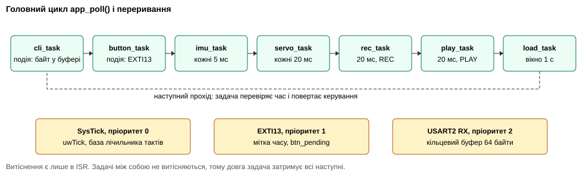
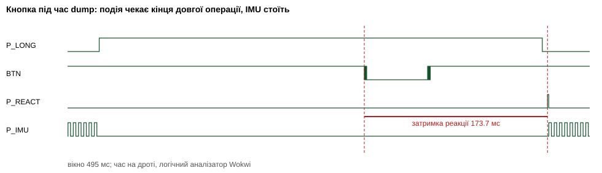
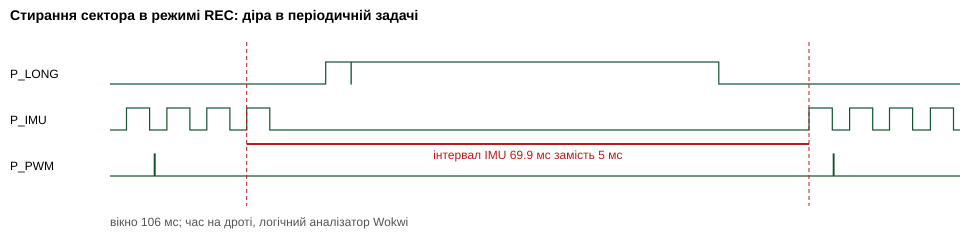

<div class="title-page">

<p class="center">МІНІСТЕРСТВО ОСВІТИ І НАУКИ УКРАЇНИ<br>
НАЦІОНАЛЬНИЙ ТЕХНІЧНИЙ УНІВЕРСИТЕТ УКРАЇНИ<br>
«КИЇВСЬКИЙ ПОЛІТЕХНІЧНИЙ ІНСТИТУТ імені ІГОРЯ СІКОРСЬКОГО»<br>
Кафедра обчислювальної техніки</p>

<br><br><br>

<p class="center"><b>ЗВІТ</b><br>
з лабораторної роботи №3<br>
з дисципліни «Системне програмування вбудованих систем»</p>

<p class="center"><b>«Реалізація вимог продукту на bare metal (super loop): вимірювання швидкодії та пам'яті, пошук меж підходу»</b></p>

<p class="center">Тема проєкту: Motion-Mirroring Teleoperator (№6, Додаток A)<br>Форма виконання: B (Wokwi), індивідуально</p>

<br><br><br>

<p class="right">Виконав:<br>студент групи ІО-31<br><b>Сас Євгеній Олександрович</b></p>

<p class="right">Перевірив:<br>Гордієнко Нікіта Юрійович</p>

<br><br>

<p class="center">Київ — 2026</p>

</div>

<div class="page-break"></div>

## Зміст

1. Мета
2. Завдання
3. Виконання
   - 3.1 Конфігурація стенда і відхилення від методички
   - 3.2 Опис прошивки
   - 3.3 Статус функціональних вимог
   - 3.4 Методика вимірювань
   - 3.5 Достовірність чисел у формі B
   - 3.6 Результати S1–S3
   - 3.7 Сценарії 6.2
   - 3.8 Порівняння результатів
   - 3.9 Використання пам'яті
   - 3.10 Реєстр обмежень
   - 3.11 Базова лінія для ЛР4
   - 3.12 Тести і CI
   - 3.13 Журнал проблем
   - 3.14 Внесок за ролями
   - 3.15 Відеозвіт
4. Висновки
5. Відповіді на контрольні питання
6. Джерела

## 1. Мета

Запустити продукт як ціле: виконати функціональні вимоги PRD в одній прошивці без операційної системи, у моделі super loop. Друга мета рівноцінна першій: виміряти швидкодію і пам'ять, знайти межі підходу і підготувати базову лінію, щоб у ЛР4 порівняти super loop із FreeRTOS тим самим методом.

## 2. Завдання

1. Реалізувати FR-01…FR-11 і для кожної показати статус із доказом.
2. Виміряти час задач, період циклу, затримку реакції, джитер і завантаження CPU у кількох сценаріях.
3. Оцінити флеш і RAM за модулями, глибину стека, heap і запас.
4. Виконати сценарії S1–S3 і 6.2, порівняти результати між собою, з PRD і з розрахунком.
5. Скласти реєстр обмежень: де super loop ламається, як це обійти без ОС і що дала б ОС.
6. Зафіксувати базову лінію для ЛР4.

## 3. Виконання

### 3.1 Конфігурація стенда і відхилення від методички

Стенд той самий, що в ЛР2: NUCLEO-C031C6, MPU-6050, W25Q64, 2 × SG92R, FT232RL, 2 LED, B1. Прошивка `ab3dcf9e`: Cortex-M0+, 48 МГц, 32 КБ флеш, 12 КБ RAM. Без ОС і без планувальника: дозволені HAL, переривання і власні буфери (розділ 3 методички).

Кожну заміну перевірено двічі: первинним джерелом і дослідом на стенді. Ось ті, що лишились, бо інакше не можна:

| Методичка | Як зроблено | Чому інакше не можна |
|---|---|---|
| NUCLEO-F411RE/F446RE | NUCLEO-C031C6 | Офіційний список Wokwi [WH] містить із STM32 лише C031, L031 і F103C8 |
| §5.1 лічильник DWT CYCCNT | `platform_cycles()`: uwTick + SysTick->VAL, 32 біти, 48 МГц, переповнення за 89,5 с | В ARMv6-M немає CYCCNT: `core_cm0plus.h` не містить DWT, те саме підтверджують [KEIL], [ST-DWT]. §5.2 сам допускає апаратний таймер |
| §5.3 аналізатор fx2lafw | логічний аналізатор Wokwi, VCD, sigrok-cli | це форма B |
| §6.2.8 вимкнути живлення | МК скидає себе посеред запису сторінки (`fault powerloss`), момент задає прошивка | У сценаріях Wokwi немає кроку живлення чи скидання [WS], PWR не реалізовано [WN], виводи NRST.1 і NRST.2 на натискання не реагують (дослід). Сценарій не може влучити у вікно запису 3 мс |
| §6.2.6 година в Wokwi CI | симулятор у VS Code, порт 4000, `tools/long_run.py` | Вільний план CI: 5 хв на сесію [WC] |

Рядки друкує власний форматер (`App/app_io.c`) замість `vsnprintf`. Це не заміна вимоги: §3 дозволяє власні модулі, а newlib не вміщається у флеш (п. П1 журналу).

Три рішення було скасовано після перевірки:

- Від'єднання сенсора (§6.2.4) і неготовий сенсор на старті (§6.2.7) спочатку імітувались програмно. Дослід показав, що кнопки послідовно в SDA і SCL справді від'єднують MPU-6050 від шини, тому обидва сценарії виконано фізично. Затиснутий SDA теж фізичний: кнопка на землю. Цього оснащення немає в `diagram.json`, воно додається лише до схем цих сценаріїв.
- LTO і вилучення команд `cap` з ЛР2 перестали бути потрібними після заміни `printf`, а LTO ще й ламає `.su` і `size *.o` з §5.4. Обидва скасовано: прошивка без LTO, команди `cap` на місці.

Підключення змінилось лише на щупи аналізатора: PA0, PA1, PA4, PB1 ([pinout.md](pinout.md)).

### 3.2 Опис прошивки



Цикл `app_poll()` викликає задачі в сталому порядку. Кожна сама перевіряє, чи настав її час, і повертає керування. Періодичні задачі мають абсолютний розклад: наступний запуск = попередній дедлайн + період. Детальна таблиця — у [tasks.md](tasks.md).

| Задача | Запуск | Дедлайн | Блокує всередині |
|---|---|---|---|
| `cli_task` | байт у буфері | відповідь ≤ 100 мс (похідний) | UART ≈ 87 мкс на байт; `dump`, `erase`, `selftest` |
| `button_task` | EXTI13 | реакція ≤ 100 мс (похідний) | друк рядка; стирання сектора при вході в REC |
| `imu_task` | 5 мс | 5 ± 0,5 мс, FR-01 | I²C 1,64 мс; timeout 5 мс при відмові |
| `servo_task` | 20 мс | FR-03 | нічого |
| `rec_task` | 20 мс | 50 Гц, FR-07 | запис сторінки раз на 2,44 с, стирання сектора раз на 39 с |
| `play_task` | 20 мс | ≤ 20 мс на 60 с, FR-08 | читання сторінки раз на 2,44 с |

Переривання три: SysTick (пріоритет 0, база часу), EXTI13 (1, мітка часу кнопки), USART2 RX (2, кільцевий буфер на 64 байти). Вся реакція виконується в циклі. Без переривань не обійтись лише тут: USART2 втрачав би байти між проходами, а мітка часу кнопки залежала б від зайнятості циклу.

Режими FR-06: LIVE (зелений LED), HOLD (жоден), REC (червоний), PLAY (обидва). Траєкторія зберігається у форматі Δ + keyframe: сторінка 256 байт містить ключовий кадр і 121 пару дельт, тобто 122 семпли, або 2,44 с. Кожна сторінка має CRC-16. Обрив запису псує лише поточну сторінку.

### 3.3 Статус функціональних вимог

Правило з §6.3: «виконана» лише тоді, коли максимум у S3 не перевищує вимоги. Жодна FR не позначена як недосяжна, бо для кожної порушеної є обхід без ОС, описаний у реєстрі. Позначка «з обмеженням» означає, що в цій прошивці вимога виконується не в усіх сценаріях.

| FR | Вимога | Виміряно | Статус | Сценарій | Обмеження |
|---|---|---|---|---|---|
| FR-01 | 200 Гц, ±0,5 мс | S1 max 87 мкс; S2 64,9 мс; S3 1093,8 мс | з обмеженням: лише без довгих операцій і логів | s1, s2, s3 | 2, 3 |
| FR-02 | статика ≤ 2° | 15°: 14,64; 30°: 29,31; 45°: 44,51 | виконана | fr02 | — |
| FR-03 | ≤ 50 мс | fr03 max 40,5 мс на виводі; S2 78,1 мс; S3 1119,3 мс | з обмеженням | fr03, s2, s3 | 1, 3 |
| FR-04 | 50 Гц, ≤ 1°, межі 10–170° | період 20000,1 мкс, 544…2400 мкс, межі працюють | виконана | fr04 | — |
| FR-05 | ±1,5°, ≤ 300 °/с | ±1° серво стоять; стрибок 82,4° за 0,82 с; у вікні одного періоду ШІМ 387,9 °/с | з обмеженням: крок заданий на такт, після блокування такти зсуваються | fr05 | 2 |
| FR-06 | цикл режимів, 2 LED | 4 + 20 натискань = 24 реакції, без пропусків | виконана; у S3 реакція до 1036,6 мс | fr06, s3 | 1 |
| FR-07 | 50 Гц, ≥ 60 с | 3001 семпл, 25 сторінок, CRC OK | виконана | fr07-08 | — |
| FR-08 | після живлення, ≤ 20 мс на 60 с | читається після скидання; різниця 37,3 мс | з обмеженням: дані цілі, таймінг порушено стиранням | fr07-08, sc8 | 3 |
| FR-09 | CLI 115200 | усі команди; `ERR` на невідому і довгу | виконана; під час `dump` втрачено 1050 байт | fr09, sc3 | 4 |
| FR-10 | > 100 мс без ACK: стоп і лог | помилка → `ERR,IMU lost` 103 мс, серво стоять, відновлення автоматичне | з обмеженням: PRD D вимагає ≤ 100 мс, а під час довгої операції виявлення запізниться | sc4 | 5 |
| FR-11 | GPIO-маркери | P_IMU, P_PWM, MARK на записі | виконана | fr03 | — |

### 3.4 Методика вимірювань

Використано всі три способи з розділу 5 методички:

- **Лічильник у прошивці.** `perf_stat_t` і формат `STAT name=... n=... min_us=... avg_us=... max_us=...` з §5.1. Читання коштує 336 тактів у симуляторі (`perfcal`), `backward=0`: лічильник монотонний. Завантаження рахується лише за проходи, де задача працювала.
- **Мітки часу МК.** `EVT t_us=... name=...` у кільцевому буфері RAM на 32 записи: вивід рядка сам коштує 3,8 мс, тому журнал друкується командою `evt` після сценарію. Перший рядок логу містить git-хеш.
- **Службові GPIO + аналізатор.** Запис у BSRR, щупи на PA0, PA1, PA4, PB1, PA9 і PC13. Обробка: Python (`tools/analyze_metrics.py`) і декодер sigrok `timing`.

Періодичні задачі міряються тисячами запусків, події — 30–50 разів. Гістограма джитера має кошики по 100 мкс, тому p99 — це межа кошика. Сценарії лежать у `docs/metrics/scenarios/`, логи у `docs/metrics/runs/`, записи у `docs/captures/lr3-*.vcd`. Усі 19 сценаріїв виконано на одній збірці `ab3dcf9e`. Випадкові моменти натискань задані зерном, тому їх повторить ЛР4.

### 3.5 Достовірність чисел у формі B

Усі часові числа нижче отримано в симуляторі. Калібрування `perfcal`: 500 ітерацій `subs + bne` займають 12 228 тактів, тобто 24,5 такта на ітерацію при номінальних 3–4. Отже, обчислення в Wokwi приблизно у 7 разів повільніші, ніж на кристалі. Це мій вимір, у документації Wokwi такого числа немає.

| Клас чисел | Приклад | Довіра | Чому | Як перевірити на залізі |
|---|---|---|---|---|
| Час UART | рядок 40 байт 3,8 мс | висока | визначається бодрейтом, розрахунок 3,47 мс | Saleae на PA2 |
| ШІМ | період 20000,1 мкс | висока | апаратний таймер у моделі | аналізатор на PB4 |
| Структура затримок | кнопка чекає кінця операції | висока | випливає з архітектури, а не з моделі | Saleae: B1 і P_REACT |
| Час стирання | 45,6 мс | середня | це tSE typ, який я сам задав у моделі; datasheet дає до 400 мс | аналізатор на P_LONG, багато секторів |
| Час I²C | 1,64 мс | низька | модель ігнорує TIMINGR і працює на 100 кГц (аномалія A4 з ЛР2). На 400 кГц очікується ≈ 0,41 мс | P_IMU і SCL на реальній платі |
| Час обчислень | `imu_task` без I²C 0,79 мс | низька | завищено ≈ 7 разів | P_IMU на реальній платі |
| Час SPI | запис сторінки 3,07 мс | низька | HAL виконується повільно; розрахунок 1,08 мс | P_LONG на реальній платі |
| Стеля частоти | 389 Гц | низька | наслідок двох попередніх рядків; на кристалі очікується кілька кГц | `sc5-break` на реальній платі |

Висновки про архітектуру від цього не залежать: відношення S3 до S1 і порядок величин задають блокування на UART і флеш, а вони достовірні. Для обчислень на залізі запас більший, ніж тут.

### 3.6 Результати S1–S3

S1: HOLD, 10 с. S2: запис 45 с, рух, `status` раз на 2 с. S3: 40 циклів `dump`, команди, рух, кнопка. Повні таблиці — у [metrics/results.md](metrics/results.md).

| Метрика | S1 | S2 | S3 | S3 − S1 | Вимога | Спосіб | Вердикт |
|---|---:|---:|---:|---:|---|---|---|
| Джитер IMU, max | 87 мкс | 64,9 мс | 1093,8 мс | 1093,7 мс | ≤ 0,5 мс FR-01 | лічильник + аналізатор | не виконана в S2, S3 |
| Джитер IMU, p99 | 100 мкс | 300 мкс | 1,6 мс | 1,5 мс | — | гістограма | — |
| Пропуски IMU | 0 | 41 | 40 | 40 | 0 | лічильник | не виконана |
| `imu_task`, avg / max | 2,43 / 2,43 мс | 2,93 / 3,00 мс | 2,70 / 2,76 мс | 0,32 мс | — | лічильник | стабільно |
| Період циклу, max | 2,6 мс | 54,1 мс | 1096,8 мс | 1094,2 мс | — | лічильник | — |
| Кнопка, max | — | — | 1036,6 мс | — | ≤ 100 мс похідна | лічильник + аналізатор | не виконана в S3 |
| Команда → відповідь, max | — | 58,2 мс | 974,7 мс | — | ≤ 100 мс похідна | лічильник | не виконана в S3 |
| Рух → CCR, max | — | 78,1 мс | 1119,3 мс | — | ≤ 50 мс FR-03 | лічильник | не виконана в S2, S3 |
| Завантаження CPU, max | 49 % | 61 % | 99 % | 50 % | — | лічильник | — |
| Глибина стека | 912 Б | 912 Б | 912 Б | 0 | — | stack painting | запас є |

У S3 за вікно вимірювання виконано лише 926 запусків IMU, бо більшу частину часу цикл стояв у `dump`.

S2 дала несподіваний результат. Я очікував, що номінальний режим зіпсує стирання сектора, а воно дало лише один із 43 довгих інтервалів на записі аналізатора. 23 припадають на `status`: відповідь на 104 байти блокує цикл щонайменше на 10,8 мс. Ще 19 припадають на закриття сторінки флеш. Цю частину симулятор завищує (розділ 3.5). Вікно підрахунку `missed` дає 41, бо два інтервали лежать поза ним.

`imu_task` у S2 довша, ніж у S1, через значення, а не через режим: у LIVE у спокої вона теж займає 2,43 мс (`sc1-erase`), а за ненульового нахилу 2,70–2,93 мс, бо `iatan2` і `isqrt` виконують більше ітерацій.

### 3.7 Сценарії 6.2

| № | Сценарій | Результат | Висновок |
|---|---|---|---|
| 1 | Довга операція і періодична задача | стирання 16 секторів: діра 733,6 мс; `dump` 502 семплів: 1059 мс; у S1 87 мкс | різниця в тисячі разів, періодична задача просто стоїть |
| 2 | Подія під час довгої операції, 50 разів | без операції max 2,7 мс, під час `dump` 409,1 мс | затримка кнопки не залежить від ISR, її задає довжина задачі |
| 3 | Потік команд | втрачено 1050 байт із 1680, відповідь max 477,6 мс | буфер 64 байти переповнюється за 5,6 мс |
| 4 | Відмова пристрою | сенсор від'єднано: NACK за 140 мкс, завантаження 5 %. SDA на землі: до 5,8 мс, завантаження 97 %. Автовідновлення в обох випадках | дорога не відмова, а timeout. Перша версія після SDA не відновлювалась (П5) |
| 5 | Точка зламу | 350 Гц без порушень, стеля 389 Гц, з 500 Гц порушення кожного запуску | ліміт: `imu_task`, 2,43 мс |
| 6 | Тривала робота, ≥ 1 год | 70 хв симуляції, 7 записів по 5 хв, 782 585 запусків IMU: 0 перезапусків, 0 помилок I²C, стек 912 Б у всіх 13 вимірах. Лічильник переповнювався понад 40 разів, джитер max не зростає: 53,8–54,0 мс у вікнах запису, 21,9–22,2 мс у вікнах відтворення. Після скидання `dump`: 15 096 семплів, 124 сторінки, CRC OK | витоків немає, heap немає, журнал цілий. За 300 с запис довший за відтворення на 139 мс: той самий ефект, що у FR-08. Цей `dump` блокує цикл на 34 с |
| 7 | Старт | перший вимір 271,1 мс, самотест 260,7 мс. Сенсор з'явився через 300 мс: 564,4 мс; через 1000 мс: 1263,5 мс | прошивка не зависає без сенсора і стартує без нього |
| 8 | Обрив запису | `TRAJ,...,pages=2,samples=244,torn=1`, `dump` і відтворення дають 244 семпли | CRC відкидає рівно одну сторінку |

Прогін 6.2.6 виконано в симуляторі VS Code, бо Wokwi CI обмежений 5 хв на сесію. Рух у ньому не задавався: автоматизація Wokwi працює лише в CLI, тому це S2 без руху. На сьомому циклі зворотний потік TCP перестав доходити до скрипта, хоч симулятор працював і команди виконував. Причину я не встановив. Фінальну перевірку журналу зроблено новим з'єднанням у тому самому запуску симулятора, це позначено в `docs/metrics/runs/long.log`.

### 3.8 Порівняння результатів

**З розрахунком.** Розбіжність понад 20 % пояснено.

| Операція | Розрахунок | Виміряно | Розбіжність | Пояснення |
|---|---|---|---|---|
| Рядок 40 байт на 115200 | 3,47 мс | 3,79 мс | +9 % | форматування рядка |
| `dump`: 8424 байти | 731 мс | 1059 мс | +45 % | 502 рядки форматуються на повільному ядрі, 5 читань сторінок по 6,4 мс |
| Стирання сектора | tSE 45 мс | 45,63 мс | +1 % | команди SPI |
| 16 секторів | 730 мс | 734 мс | +1 % | — |
| I²C, 17 байт по 9 біт на 100 кГц | 1,53 мс | 1,64 мс | +7 % | START, STOP, пауза між записом і читанням (A2) |
| Запис сторінки: 260 байт на 3 МГц + tPP 0,4 мс | 1,09 мс | 3,07 мс | +182 % | HAL_SPI на повільному ядрі (розділ 3.5) |
| Читання сторінки на 3 МГц | 0,69 мс | 6,44 мс | +833 % | те саме, плюс передача порціями по 16 байт (`spi_transfer`) |

**Між способами вимірювання.**

| Метрика | Лічильник МК | Журнал EVT | Аналізатор, Python | Декодер timing |
|---|---:|---:|---:|---:|
| Стирання сектора, avg, n = 64 | 45 631 мкс | 45 672 мкс | 45 703 мкс | 45 703 мкс |
| Затримка кнопки, avg, n = 50 | 765 мкс | — | 768 мкс | — |
| Затримка кнопки, max | 2668 мкс | — | 2671 мкс | — |

Звідки різниця:

- Лічильник найменший, бо замикає лише сам виклик драйвера.
- EVT більший на 41 мкс: мітка береться раніше, а `app_evt` сам виконується.
- Аналізатор більший на 72 мкс: P_LONG піднімається ще до `app_evt` і опускається після.
- Для кнопки аналізатор бачить на 3 мкс більше: це вхід у переривання, який прошивка не бачить.

Дві незалежні обробки VCD збіглись до 0,1 мкс.

**Анотований запис.** Під час `dump` кнопка чекає кінця операції:



Під час стирання сектора в REC:



### 3.9 Використання пам'яті

Повний звіт — [metrics/memory.md](metrics/memory.md).

```
Memory region   Used Size  Region Size  %age Used
          RAM:     3848 B       12 KB     31.32%
        FLASH:    31484 B       32 KB     96.08%
```

| Шар | Флеш, Б | Частка |
|---|---:|---:|
| App | 9880 | 35,3 % |
| Drivers (HAL) | 8934 | 31,9 % |
| libc і libgcc | 3740 | 13,4 % |
| Core | 1878 | 6,7 % |
| Platform | 1814 | 6,5 % |
| Devices | 1730 | 6,2 % |

Частки пораховано за символами ELF, без таблиці векторів і констант. Найбільші символи: `selftest_run` 1112 Б, `main` 1052 Б, `app_cap` 952 Б. Найбільша змінна в RAM — `app`, 1288 Б, із них 256 Б буфер сторінки.

| Стек | Байт |
|---|---:|
| Виміряно stack painting | 912 |
| Статична оцінка від `main` | 1020 |
| ISR з кадрами винятків, вкладені | 176 |
| Статичний найгірший випадок | 1196 |
| Резерв лінкера | 1024 |

Виміряний максимум припадає на самотест при старті. Статична оцінка більша, бо враховує і ланцюжки, що не трапляються: через виклики за вказівником скрипт перебирає всі можливі цілі. Вона перевищує резерв лінкера на 172 Б, але це не переповнення: резерв лише гарантує мінімум, а між `.bss` і стеком лишається близько 10 КБ вільної RAM. Вкладення трьох ISR у найглибшому місці самотесту не спостерігалось, тому виміряне число його не містить.

Heap не використовується: `malloc` і `_sbrk` в образі відсутні. Запас флеш — 1,3 КБ, RAM — близько 8,4 КБ. Флеш тут вузьке місце, і це важливо для ЛР4.

### 3.10 Реєстр обмежень

Повний текст із доказами й аналізом ОС — у [limitations.md](limitations.md).

| № | Категорія | Обмеження | Доказ | Гіпотеза для ЛР4 |
|---|---|---|---|---|
| 1 | час реакції | реакція = найдовша задача | кнопка 2,7 → 1036,6 мс | ≤ 10 мс |
| 2 | джитер | синхронний лог ламає період | 23 пропуски від `status` у S2 | 0 |
| 3 | довгі операції | флеш блокує все | 64,9 мс, FR-08 37,3 мс | ≤ 3 мс, ≤ 20 мс |
| 4 | спільні ресурси | вхідний буфер | 1050 байт втрачено | 0 |
| 5 | обробка відмов | timeout стає часом циклу | завантаження 97 %, 107 мс | інші задачі не страждають |
| 6 | межа частоти | час задач додається | 389 Гц | на 2–5 % нижче |
| 7 | модульність | нова задача — 7 місць | перелік у реєстрі | 2 місця |
| 8 | пам'ять | флеш 96 % | `memory.md` | лише з `-flto` |

Що super loop робить краще: детермінізм без довгих операцій (±90 мкс у S1), RAM 3,8 КБ, старт 271 мс, простота налагодження, лише три пари спільних даних.

### 3.11 Базова лінія для ЛР4

Окремий документ — [baseline-lab4.md](baseline-lab4.md). Він містить точні команди відтворення, таблицю метрик, гіпотези й перелік інструментів, що переносяться без змін.

### 3.12 Тести і CI

Хостові тести з ЛР2 продовжують працювати, додано нові модулі: `test_perf`, `test_motion`, `test_traj`. Разом 109 тестів, 0 помилок, покриття рядків Devices і App 97,4 %, гілок 88,5 %. Тест `test_torn_page_is_detected_and_dropped` і перевірка кожного перевернутого біта покривають цілісність журналу, контрольне значення CRC взято зі стандарту. CI збирає обидві цілі, запускає тести й перевіряє відтворюваність збірки.

### 3.13 Журнал проблем

| № | Симптом | Root cause | Виправлення | Коміт |
|---|---|---|---|---|
| П1 | Лінкер: прошивка 39,5 КБ при 32 КБ | `vsnprintf` із `fvwrite` і `malloc` займає майже 4 КБ, HAL майже 9 КБ | власний форматер рядків, heap зник | `ff3415e` |
| П2 | `perfcal` дав `backward=1`, `loop max = 89 с` | модель Wokwi не показує `PENDSTSET` і `COUNTFLAG`, перенос SysTick під забороною переривань не видно | подвійне читання uwTick, SysTick з пріоритетом 0 | `ff3415e` |
| П3 | Тест форматера: `stack smashing` | буфер на 11 символів мало для 64-бітного `long` на хості | розмір від `sizeof(unsigned long)` | `ff3415e` |
| П4 | Перша затримка рух → PWM 607 мс | на першому семплі різниця з нулем дала хибне «рух виявлено» | детектор працює лише після першого семпла | `ff3415e` |
| П5 | Після затиснутого SDA сенсор не відновлюється | контролер лишається в BUSY, скидання PE не допомагає | 9 тактів SCL, STOP, скидання блока через RCC | `ab3dcf9` |
| П6 | Сценарії 6.2.4 і 6.2.7 йшли через команду, а не через фізичну дію | хибне припущення, що у Wokwi не можна від'єднати сенсор | кнопки послідовно в SDA, SCL на схемах сценаріїв | `ab3dcf9` |
| П7 | `sc2-btn-long` завис, `samples=1` | кнопка в HOLD переводить у REC, а це стирає траєкторію для `dump` | сценарій працює в LIVE | `ab3dcf9` |
| П8 | Аналізатор нарахував 5038 натискань | кнопка Wokwi імітує брязкіт, кожне натискання дає близько 100 фронтів | натискання рахується після паузи 20 мс | `ab3dcf9` |
| П9 | Після `make mem` могла перезапуститись симуляція | звіт перелінковував ELF, за яким стежить VS Code | окремий каталог `build-mem` | COMMIT_FINAL |

### 3.14 Внесок за ролями

Робота виконана індивідуально: Сас Є. О. відповідає за всі ролі розділу 9.

| № | Роль | Виконавець | Артефакти | Коміти |
|---|---|---|---|---|
| 1 | Розробка super loop | Сас Є. О. | `firmware/App`, `firmware/Platform`, `docs/tasks.md` | `ff3415e`, `ab3dcf9` |
| 2 | Метрики | Сас Є. О. | `App/perf.*`, `tools/analyze_metrics.py`, `tools/mem_report.py` | `ff3415e`, `ab3dcf9`, COMMIT_FINAL |
| 3 | Тестування | Сас Є. О. | `tools/run_scenarios.py`, `docs/metrics/` | `ab3dcf9`, COMMIT_FINAL |
| 4 | Тестування на обладнанні | Сас Є. О. | `docs/captures/lr3-*`, логи прогонів (симулятор) | COMMIT_FINAL |
| 5 | Звіт | Сас Є. О. | `docs/limitations.md`, `docs/baseline-lab4.md`, цей звіт, відео | COMMIT_FINAL |

### 3.15 Відеозвіт

Відео (2–3 хв, з голосом): VIDEO_LINK. Зміст: продукт у сценарії S3, реакція на подію під час довгої операції, фрагмент вимірювання логічним аналізатором.

## 4. Висновки

- Продукт працює як ціле: усі 11 вимог реалізовано в одній прошивці без ОС. Шість виконано повністю, п'ять — з обмеженням. Недосяжних немає.
- Super loop чудово тримає час, поки немає довгих операцій: джитер IMU 87 мкс і 0 порушень на 2001 запуск.
- Межа проявилась різко. Перша ж довга задача зупиняє періодичну на весь свій час: джитер виріс з 87 мкс до 1,09 с, кнопка з 2,7 мс до 1,04 с.
- Найнесподіваніше: у S2 найбільше пропусків дав не стирання, а звичайний `status`: 23 довгі інтервали проти одного від стирання. Частий блокувальний вивід у сумі шкодить більше за рідкісну довгу операцію.
- Дані не постраждали навіть у найгіршому випадку: CRC відкинула рівно одну сторінку після обриву запису.
- Вузьке місце пам'яті — флеш, 96 %, а не RAM, 31 %.

**Чи потрібна цьому продукту ОС?** Так, якщо запис і вивід мають працювати разом із дзеркаленням руху. Вимога 50 мс у FR-03 і 5 мс у FR-01 порушуються в S2 і S3, а причина — відсутність витіснення: процесор чекає флеш чи UART, хоча міг би обслуговувати IMU. Частину можна вирішити без ОС: передача через переривання прибере пропуски від `status`, машина станів флеш — пропуски від запису. Але таких машин станів знадобиться кілька (UART, флеш, I²C, відновлення шини), і кожна ускладнює код більше, ніж пара задач із пріоритетами. Для режиму лише дзеркалення без запису й логів ОС не потрібна: там super loop вкладається у вимоги із запасом. Ціна ОС на цьому кристалі реальна: флеш майже вичерпано, тому в ЛР4 доведеться ввімкнути `-flto`.

## 5. Відповіді на контрольні питання

1. **Головний цикл і найгірша затримка.** Задачі йдуть послідовно: `cli`, `button`, `imu`, `servo`, `rec`, `play`. Подія кнопки, що виникла одразу після `button_task`, чекає кінця проходу: T_max = T_imu + T_servo + T_rec + T_play + T_cli + T_вхід_ISR. Найбільший доданок задає `T_cli` у `dump`: у S3 виміряно 1036,6 мс.
2. **Джитер.** Відхилення інтервалу між запусками від періоду. Міряю як `dt − 5000` у `imu_task` за лічильником і незалежно за фронтами P_IMU. Причина у прошивці — блокувальні задачі перед `imu_task`: відповідь `status` понад 10 мс, закриття сторінки, стирання сектора, `dump`.
3. **Найгірший час.** Дедлайн порушує найгірший випадок, а середнє його ховає: в S2 p99 джитера 300 мкс, а max 64,9 мс. Щоб максимум був справжнім, сценарій навмисно викликає довгу операцію в S2 і S3, повторюється тисячі разів і перевіряється незалежно аналізатором.
4. **DWT.** У Cortex-M0+ його немає, тому лічильник складено з uwTick і SysTick->VAL. Різниця беззнакових 32-бітних значень обчислюється за модулем 2³², тому після одного переповнення лишається правильною. Некоректною стає, якщо інтервал довший за період лічильника: тут 89,5 с. Годинний прогін це перевірив.
5. **Час на хості.** USB і буферизація додають непередбачувану затримку в мілісекунди, тому беру час МК у самому рядку `EVT`.
6. **ISR.** Можна: коротко забрати дані, поставити мітку, прапорець, очистити джерело. Не можна: чекати, друкувати, викликати блокувальні функції. Функція HAL із timeout у ISR з пріоритетом вище SysTick зависне: `HAL_GetTick()` не зростатиме, бо SysTick не отримає керування. У моїй прошивці SysTick найвищий, тому час ітиме, але довге очікування все одно заблокує цикл.
7. **volatile.** Гарантує, що кожне читання і запис справді відбудеться, і компілятор не викине їх. Не гарантує атомарності й порядку відносно неvolatile-даних. Приклад: `btn_stamp` і `btn_pending` — одного `volatile` мало, узгодженість дає порядок: мітка читається до скидання прапорця, а ISR пише її лише коли прапорець скинуто.
8. **text, data, bss.** text — код і константи, data — ініціалізовані змінні (у флеш і в RAM), bss — обнулені змінні в RAM. У виводі: 31 364, 120, 3736. Стек формується під час виконання, тому `size` показує лише зарезервовану секцію.
9. **Статична і виміряна оцінка.** Статична сумує кадри найглибшого ланцюжка за графом викликів, виміряна показує лише реально пройдений шлях. У мене статична більша: 1020 проти 912 Б, бо через виклики за вказівником враховує ланцюжки, яких не буває.
10. **Камера.** У теми 6 камери немає. Найбільший буфер тут — сторінка флеш, 256 байт. Для порівняння: кадр QVGA RGB565 зайняв би 153 КБ при 12 КБ RAM.
11. **Відмова I²C.** Сенсор зник: NACK за 140 мкс, цикл не страждає. SDA на землі: кожне читання чекає timeout до 5,8 мс, завантаження 97 %. Через понад 100 мс без ACK — `ERR,IMU lost`, серво стоять, кожні 100 мс відновлення шини. Коли сенсор повертається, робота відновлюється сама, хоч `mpu6050_init` блокує цикл ще на 107 мс.
12. **Найсерйозніше обмеження.** Реакція дорівнює найдовшій задачі, тому FR-01 і FR-03 залежать від `dump` і запису. Розв'яже витіснення: IMU з найвищим пріоритетом. Нові ризики: інверсія пріоритетів на спільному SPI і UART, взаємне блокування, переповнення стека задачі, нестача флеш.
13. **Що super loop робить краще.** Детермінізм без довгих операцій (±90 мкс), RAM 3,8 КБ, один стек 912 Б, старт 271 мс, сталий порядок виконання.

## 6. Джерела

1. [UM] STMicroelectronics. UM2953, STM32C0 Nucleo-64 boards.
2. [RM] STMicroelectronics. RM0490, STM32C0x1 reference manual.
3. [DS] STMicroelectronics. DS13867, STM32C031x4/x6 datasheet.
4. [W25] Winbond. W25Q64JV datasheet, Rev. J: таблиця AC Electrical Characteristics.
5. [PS], [RMAP] InvenSense. MPU-6000/MPU-6050 Product Specification і Register Map.
6. [I2C] NXP. UM10204, I2C-bus specification: §3.1.16 Bus clear.
7. [CMSIS] Arm. CMSIS `core_cm0plus.h`: у цьому файлі немає DWT (репозиторій, `firmware/Drivers/CMSIS/Include`).
8. [KEIL] Keil. [Cortex-M0/M0+ without DWT CYCCNT](https://www.keil.com/support/docs/3999.htm).
9. [ST-DWT] ST Community. [There is no DWT in the M0/M0+ kernel](https://community.st.com/stm32-mcus-products-25/there-is-no-dwt-in-the-m0-m0-kernel-11427).
10. [WH] Wokwi. [Supported hardware](https://docs.wokwi.com/getting-started/supported-hardware).
11. [WN] Wokwi. [ST Nucleo C031C6](https://docs.wokwi.com/parts/board-st-nucleo-c031c6): не реалізовано DMA, IWDG, PWR.
12. [WS] Wokwi. [Automation scenarios](https://docs.wokwi.com/wokwi-ci/automation-scenarios).
13. [WC] Wokwi. [CI getting started](https://docs.wokwi.com/wokwi-ci/getting-started): 50 хв на 30 днів, 5 хв на сесію.
14. M. J. Pont. Patterns for Time-Triggered Embedded Systems. Addison-Wesley.
15. E. White. Making Embedded Systems. O'Reilly.
16. R. Barry. Mastering the FreeRTOS Real Time Kernel.
