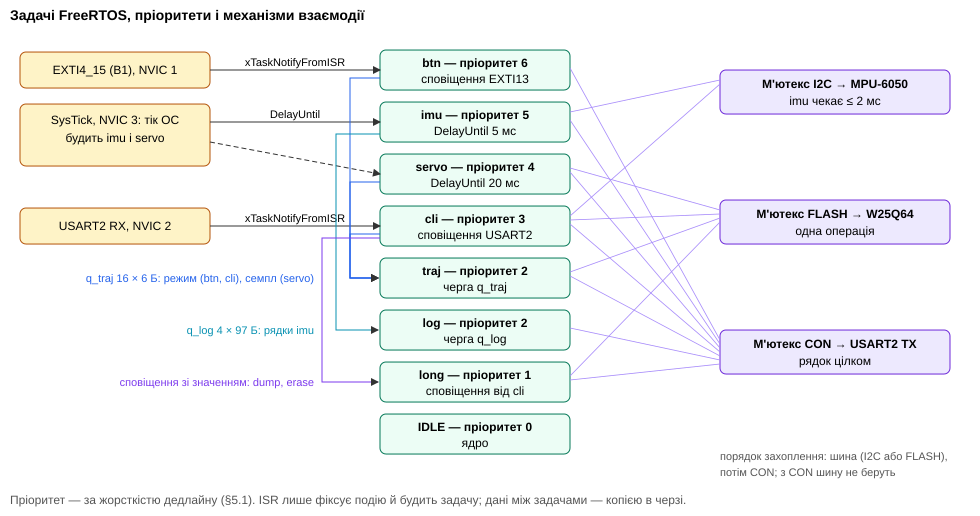
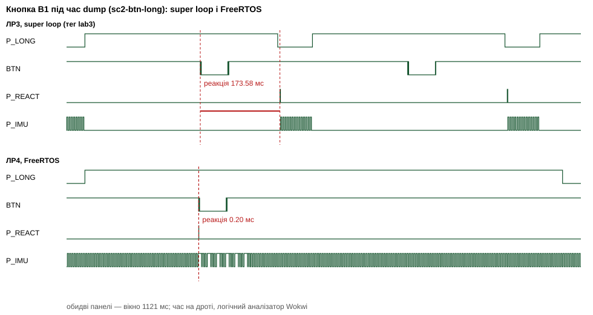
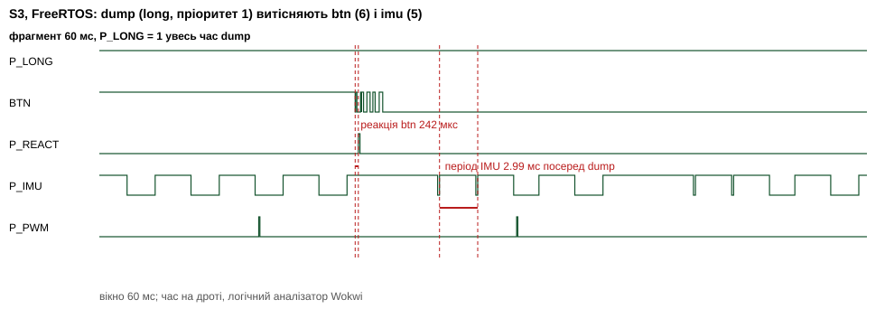
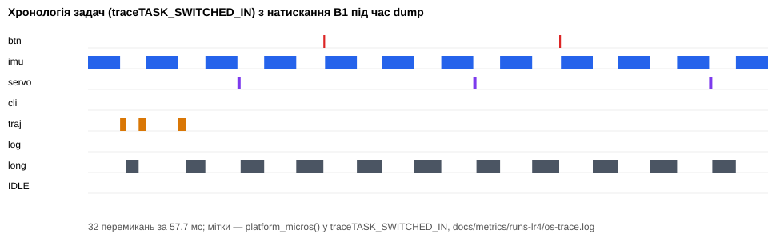

МІНІСТЕРСТВО ОСВІТИ І НАУКИ УКРАЇНИ 
НАЦІОНАЛЬНИЙ ТЕХНІЧНИЙ УНІВЕРСИТЕТ УКРАЇНИ 
«КИЇВСЬКИЙ ПОЛІТЕХНІЧНИЙ ІНСТИТУТ імені ІГОРЯ СІКОРСЬКОГО» 
Кафедра обчислювальної техніки

   

<b>ЗВІТ</b> 
з лабораторної роботи №4 
з дисципліни «Системне програмування вбудованих систем»

<b>«Реалізація вимог продукту на FreeRTOS: перехід від super loop до задач ОС і кількісне порівняння підходів»</b>

Тема проєкту: Motion-Mirroring Teleoperator (№6, Додаток A) Форма виконання: B (Wokwi), індивідуально

   

Виконав: студент групи ІО-31 <b>Сас Євгеній Олександрович</b>

Перевірив: Гордієнко Нікіта Юрійович

  

Київ — 2026

## Зміст

1. Мета
2. Завдання
3. Виконання
   - 3.1 Конфігурація стенда і відхилення від методички
   - 3.2 Схема задач
   - 3.3 Конфігурація ядра
   - 3.4 Методика вимірювань і достовірність
   - 3.5 Статус функціональних вимог для обох підходів
   - 3.6 Порівняльна таблиця
   - 3.7 Метрики ОС
   - 3.8 Сценарії, специфічні для ОС
   - 3.9 Хронологія виконання задач
   - 3.10 Перевірка гіпотез з ЛР3
   - 3.11 Тести і CI
   - 3.12 Журнал проблем
   - 3.13 Внесок за ролями
   - 3.14 Відеозвіт
4. Висновки
5. Відповіді на контрольні питання
6. Джерела

## 1. Мета

Реалізувати той самий продукт, що й у ЛР3, на FreeRTOS і з'ясувати в цифрах, що ОС дала і що забрала. Головний результат — не прошивка, а порівняння двох підходів, у якому кожне твердження підтверджено вимірюванням тим самим методом у тих самих сценаріях.

## 2. Завдання

1. Перенести FR-01…FR-11 на FreeRTOS з тим самим командним інтерфейсом, форматом логів і вимірюванням.
2. Спроєктувати задачі, пріоритети й механізми взаємодії та обґрунтувати їх вимогами PRD і реєстром обмежень ЛР3.
3. Повторити всі вимірювання ЛР3 для обох прошивок в один день і доповнити метриками ОС: завантаження за задачами, стек кожної задачі, heap ОС, вартість тіку й перемикання контексту.
4. Перевірити кожну гіпотезу з реєстру обмежень ЛР3.
5. Виміряти нові проблеми ОС: інверсію пріоритетів, переповнення стека, голодування, вичерпання черги й heap, вплив частоти тіку.
6. Обрати підхід для продукту й аргументувати вибір числами.

## 3. Виконання

### 3.1 Конфігурація стенда і відхилення від методички

Стенд той самий, що в ЛР2–ЛР3: NUCLEO-C031C6 (Cortex-M0+, 48 МГц, 32 КБ флеш, 12 КБ RAM), MPU-6050, W25Q64, 2 × SG92R, FT232RL, 2 LED, B1. UART 115200, SPI 3 МГц, I²C 400 кГц у налаштуваннях. `diagram.json`, моделі мікросхем і `wokwi.toml` у тегу `lab3` і в ЛР4 збігаються (`git diff lab3 HEAD -- chips diagram.json wokwi.toml` порожній).

Обидві прошивки зібрано з одного репозиторію і виміряно в один день, 4 листопада 2026 р., тими самими сценаріями:

- **ЛР3** — тег `lab3`, git worktree `build-lr3/`, у логах `git=lab3`;
- **ЛР4** — гілка `lab4`, у логах `git=dd8c0d9f`.

Скрипт `tools/run_scenarios.py --fw lr3|lr4` збирає кожну прошивку в Docker перед прогоном.

Кожну заміну перевірено двічі: первинним джерелом і дослідом. Лишились такі:

| Методичка | Як зроблено | Чому інакше не можна |
|---|---|---|
| §3: порт GCC/ARM_CM4F | порт GCC/ARM_CM0 | Стенд ЛР1–ЛР3 — Cortex-M0+ (ARMv6-M): немає FPU і регістра BASEPRI. Для M0/M0+ ядро має окремий порт `ARM_CM0` [FRK]. Дослід: `port.c` з `ARM_CM4F`, зібраний з `-mcpu=cortex-m0plus`, дає `#error This port can only be used when the project options are configured to enable hardware floating point support` і `configMAX_SYSCALL_INTERRUPT_PRIORITY undeclared`. Міняти МК не можна: §2 вимагає того самого стенда |
| §4.10: `configMAX_SYSCALL_INTERRUPT_PRIORITY`, `NVIC_PRIORITYGROUP_4` | у порту ARM_CM0 їх немає. Критична секція — `cpsid i`, що маскує всі переривання. API `FromISR` можна кликати з будь-якого пріоритету | В ARMv6-M немає BASEPRI і груп пріоритетів, лише 2 біти пріоритету (`__NVIC_PRIO_BITS = 2`). У CMSIS `__NVIC_SetPriorityGrouping(X)` визначено як `(void)(X)` (`core_cm0plus.h:748`), порт маскує через `cpsid i` (`portmacro.h:308`) |
| §6.2: `portGET_RUN_TIME_COUNTER_VALUE() = DWT->CYCCNT` | `platform_micros()`: мкс від TIM14 | DWT на Cortex-M0+ немає (ЛР3, [KEIL], [ST-DWT]). SysTick тепер належить ОС, тому лічильник тактів ЛР3 (`uwTick` + `SysTick->VAL`) переїхав на TIM14, як «Timebase Source» у §4.10. Роздільність та сама, 1 такт 48 МГц; `perfcal` в обох прошивках дає `backward=0` |
| §7.1, тривала робота ≥ 1 год | симулятор у VS Code, `tools/long_run.py --fw lr3` і `--fw lr4` | як у ЛР3: Wokwi CI обмежує сесію 5 хвилинами [WC] |

Ще одне рішення стосується лише симулятора, а не методички. Модель Cortex-M0+ у Wokwi ставить PRIMASK на `cpsid i`, але переривань не блокує (розділ 3.12, П2). Тому збірка `BOARD_TARGET=wokwi` емулює PRIMASK: тік, PendSV і виклики ядра з переривань, що прийшли під маскою, виконуються в момент її зняття. Збірка для плати використовує незмінений порт.

### 3.2 Схема задач

Пріоритети призначено за правилом §5.1: що жорсткіший дедлайн, то вищий пріоритет, а довгі операції — внизу. Повна схема з обґрунтуванням кожного механізму — у [rtos-design.md](rtos-design.md).

| Задача | Пріоритет | Запуск | Період / дедлайн | FR | Стек, слів | Запас після S3, слів | Чому такий пріоритет |
|---|---:|---|---|---|---:|---:|---|
| `btn` | 6 | сповіщення від EXTI13 | реакція ≤ 100 мс | FR-06 | 112 | 50 | найкоротша робота, найжорсткіший час реакції |
| `imu` | 5 | `vTaskDelayUntil`, 5 мс | 5 ± 0,5 мс | FR-01, 02, 10, 11 | 160 | 42 | найжорсткіший період |
| `servo` | 4 | `vTaskDelayUntil`, 20 мс | наступний період ШІМ | FR-03, 04, 05, 07, 08 | 160 | 106 | період 20 мс, рух → CCR ≤ 50 мс |
| `cli` | 3 | сповіщення від USART2 RX | відповідь ≤ 100 мс | FR-09 | 320 | 147 | людина чекає, мілісекунди не критичні |
| `traj` | 2 | черга `q_traj` | семпл — за 0,32 с | FR-06, FR-07 | 192 | 69 | запис у флеш можна відкласти |
| `log` | 2 | черга `q_log` | — | FR-10 | 96 | 24 | друк для `imu`: періодична задача не чекає UART |
| `long` | 1 | сповіщення від `cli` | сотні мс | FR-09 (`dump`, `erase`) | 176 | 61 | довга і некритична |
| `IDLE` | 0 | ядро | — | — | 64 | 43 | простій, завантаження CPU |

Механізми взаємодії:

- **ISR → задача:** сповіщення задачі (`xTaskNotifyFromISR`). У кожного переривання один отримувач, а сповіщення — найлегший механізм (§4.5). Байти UART лишились у кільцевому буфері ISR з ЛР3: stream buffer коштував би 1,7 КБ флеш, а вільних лишається 44 Б.
- **Дані між задачами:** черги з копією. `q_traj` (16 × 6 Б) несе запити режиму від `btn` і `cli` та семпли траєкторії від `servo`. Режим змінює лише `traj`, бо REC і PLAY працюють із флеш. `q_log` (4 × 97 Б) несе рядки від `imu`, тому `imu` ніколи не чекає UART.
- **Спільні ресурси:** м'ютекси `I2C`, `FLASH`, `CON`, усі з успадкуванням пріоритету. Порядок захоплення фіксований: спершу шина, потім `CON`, і задача, що тримає `CON`, шини не бере. Цикл очікування неможливий, тож взаємного блокування немає. `imu` чекає `I2C` не довше 2 мс. Якщо не дочекалась, семпл пропускається і рахується в `OSCNT i2c_busy`.
- **Тік → періодичні задачі:** `vTaskDelayUntil`. Пропущені періоди не наздоганяються, як і в ЛР3.

Прикладний шар `firmware/App/` не знає про ОС. Тіло кожної задачі — функція `app_*_step()` з ЛР3, а черги, м'ютекси й сповіщення доступні їй лише через таблицю `app_hw_t`. Тому 109 хостових тестів ЛР3 працюють без ОС, а `tools/check_deps.py` перевіряє, що `App/` не включає заголовків FreeRTOS.

### 3.3 Конфігурація ядра

Версія: FreeRTOS-Kernel **V11.3.1**, git submodule `firmware/Middlewares/FreeRTOS`, коміт `3a22924`. Порт `GCC/ARM_CM0`, heap_4, тік 1000 Гц. Конфігурація — `firmware/Core/Inc/FreeRTOSConfig.h`.

| Параметр | Значення | Типове | Навіщо змінено |
|---|---|---|---|
| `configTICK_RATE_HZ` | 1000 | 1000 | роздільність затримок 1 мс; варіант 100 Гц — для §7.2.6 |
| `configMAX_PRIORITIES` | 7 | 5 | рівно стільки рівнів, скільки потрібно: кожен рівень — список у RAM |
| `configUSE_PORT_OPTIMISED_TASK_SELECTION` | 0 | 1 | на Cortex-M0+ немає інструкції CLZ |
| `configMINIMAL_STACK_SIZE` | 64 слова | 128 | стек idle; виміряний запас 43 слова |
| `configTOTAL_HEAP_SIZE` | 7680 Б | залежить від демо | 8 стеків, 8 TCB, 2 черги, 3 м'ютекси: оцінка 6880 Б, виміряно на піку 7184 Б |
| heap | heap_4 | — | об'єкти створюються лише на старті, але heap_4 дає `xPortGetMinimumEverFreeHeapSize()` для §6.4 |
| `configCHECK_FOR_STACK_OVERFLOW` | 2 | 0 | перевірка шаблону наприкінці стека при кожному перемиканні (§6.3) |
| `configUSE_MALLOC_FAILED_HOOK` | 1 | 0 | сигнал вичерпання heap (§7.2.5) |
| `configUSE_TICK_HOOK` | 1 | 0 | вікно завантаження CPU 1 с: `LOAD` з ЛР3 тепер дорівнює 100 % мінус частка idle |
| `configGENERATE_RUN_TIME_STATS`, `configUSE_TRACE_FACILITY`, `configUSE_STATS_FORMATTING_FUNCTIONS` | 1 | 0 | команда `tasks` (§6.2) |
| `portGET_RUN_TIME_COUNTER_VALUE()` | `platform_micros()` | — | мкс, переповнення через 71,6 хв |
| `traceTASK_SWITCHED_IN()` | облік idle і буфер хронології | порожній | §6.5, хронологія задач |
| `configUSE_TIMERS`, `configUSE_EVENT_GROUPS`, `configUSE_STREAM_BUFFERS` | 0 | 1 | не потрібні, а кожен коштує сотні байтів флеш |
| `configASSERT` | друк рядка і зупинка | не задано | діагностика неправильного використання API |

**HAL і SysTick (§4.10).** SysTick тепер належить ядру, тому HAL переведено на TIM14: `HAL_InitTick()` перевизначено в `Platform/platform.c`, так само як «Timebase Source» у CubeMX. TIM14 рахує такти всередині мілісекунди, тож пара `uwTick` + `TIM14->CNT` дає 32-бітний лічильник тактів для вимірювань.

| Переривання | Пріоритет NVIC | API ядра |
|---|---:|---|
| TIM14 — база часу HAL і лічильник тактів | 0 | немає |
| EXTI4_15 — кнопка B1 | 1 | `xTaskNotifyFromISR` |
| USART2 RX — консоль | 2 | `xTaskNotifyFromISR` |
| SysTick — тік ОС | 3 | порт |
| PendSV — перемикання контексту | 3 | порт |

SysTick і PendSV мають найнижчий пріоритет, як вимагає порт. Переривання вищого пріоритету ядро не затримує, крім коротких критичних секцій з `cpsid i`.

**Пам'ять.** Ядро займає 7409 Б флеш, а прошивка ЛР3 уже займала 31,5 з 32 КБ. Щоб вмістити ядро, не прибравши жодної функції ЛР3, зроблено таке:

- LTO для власного коду й HAL; ядро зібрано без LTO, щоб map-файл показував внесок кожного об'єкта;
- ініціалізацію тактування, UART, SPI, TIM3 і GPIO переписано на регістри з тими самими значеннями;
- обмін SPI та I²C переписано на регістри: сигнали на шинах ті самі, змінилась лише кількість інструкцій між байтами;
- `strtol` замінено власним розбором чисел.

Сценарії §7.2 і буфер хронології в продуктову збірку не вмістились, тому вони у варіанті `RTOS_FAULTS=1`. Варіанти збірки: `RTOS_TICK_HZ`, `RTOS_HEAP_BYTES`, `RTOS_STACK_IMU`, `RTOS_STACK_CHECK`, `RTOS_FAULTS`.

### 3.4 Методика вимірювань і достовірність

Інструментарій ЛР3 перенесено без змін (§6): команди `stats`, `mem`, `evt`, `perfcal`, `rate`, формати `STAT`, `JITTER`, `LOAD`, `CNT`, `HIST`, `EVT`, службові піни PA0 P_IMU, PA1 P_PWM, PA4 P_LONG, PB1 P_REACT, PA9 MARK, логічний аналізатор Wokwi і скрипти `tools/analyze_metrics.py`, `tools/analyze_captures.py`. Логи обох прошивок обробляє той самий скрипт (`--fw lr3|lr4`).

Що додано для ОС:

- **Завантаження за задачами (§6.2).** Команда `tasks` друкує `vTaskGetRunTimeStatistics()` і лічильник перемикань. Сценарій знімає її до і після вікна вимірювання, а `tools/compare.py` бере різницю двох знімків. Обхід задач вимикає планувальник, тому обидва знімки лежать поза вікном, де рахуються таймінги.
- **Стек кожної задачі (§6.3).** Команда `stack` після S3: `usStackHighWaterMark` з `uxTaskGetSystemState()` і стек переривань MSP методом stack painting, як у ЛР3.
- **Heap ОС (§6.4).** Команда `heap`: `xPortGetFreeHeapSize()`, `xPortGetMinimumEverFreeHeapSize()`, `configTOTAL_HEAP_SIZE`.
- **Вартість ОС (§6.5).** Команда `ctxsw`: 1000 разів `cli` (пріоритет 3) будить `btn` (пріоритет 6) сповіщенням. Міряються такти від моменту перед `xTaskNotify()` у `cli` до першої інструкції після `xTaskNotifyWait()` у `btn`, тобто сам виклик API, PendSV і повернення з очікування. Тривалість обробника тіку міряється лічильником тактів в обгортці `SysTick_Handler`. Внесок кожного об'єкта ядра у флеш і RAM береться з map-файла (`tools/mem_report_lr4.py`).
- **Затримка «ISR → задача».** Це `STAT name=btn_latency`: від мітки часу в ISR EXTI до реакції в задачі `btn`, як і в ЛР3. Незалежна перевірка — аналізатор між фронтом BTN і P_REACT.
- **Хронологія (§6.5).** `traceTASK_SWITCHED_IN()` пише номер задачі й мітку часу в буфер на 32 записи, а команда `trace` друкує його після сценарію.

Семантика двох лічильників змінилась, бо змінилась архітектура. `STAT name=loop` у ЛР4 завжди 0, бо циклу немає. `LOAD` у ЛР3 означав частку проходів циклу, де працювала хоч одна задача, а в ЛР4 це 100 % мінус частка idle. Обидва показують зайнятість процесора, але в ЛР3 активне очікування UART і флеш теж рахується зайнятістю.

**Достовірність у формі B.** Застереження ЛР3 (розділ 3.5) лишаються: обчислення в Wokwi приблизно в 7 разів повільніші, ніж на кристалі (`perfcal`: 24,5 такта на ітерацію `subs + bne` замість 3–4), час I²C завищено. Для ЛР4 додаються два:

1. **Вартість перемикання контексту й тіку виміряно в тактах моделі.** На кристалі вона буде меншою приблизно в стільки ж разів, у скільки модель повільніша на звичайному коді.
2. **Емуляція PRIMASK додає роботу.** У збірці для Wokwi кожне зняття маски перевіряє відкладені тіки, PendSV і виклики ядра з EXTI та USART2. Отже, накладні витрати ядра тут завищені ще й цим. Збірка для плати цього коду не містить.

Структурні висновки від цього не залежать: які задачі кого витісняють, що чекає на що, скільки RAM займає кожен об'єкт.

**Обмеження CI і розбиття сесій.** Безкоштовний Wokwi CI обриває сесію через 5 хв реального часу («Connection timed out after 5 minutes. Upgrade your plan»), а розширення VS Code сценаріїв автоматизації не виконує [WS]. S3 на FreeRTOS займає ≈ 140 с симуляції, тобто ≈ 9 хв сесії: `dump` тепер ділить процесор з IMU. Тому S3 іде трьома сесіями тієї самої послідовності циклів (14 + 13 + 13, те саме зерно), а FR-07/08 — двома: запис → скидання → відтворення і запис → `dump`. Для обох прошивок однаково. Метрики частин злито в `tools/analyze_metrics.py`: n — сума, min і max — крайні, середнє — зважене, пропуски й порушення — сума. Кожна сесія починається так само, із запису 10 с, тож вікна вимірювання ті самі. Розбиття не змінює результату: у звіті ЛР3 S3 однією сесією дав кнопку max 1036,6 мс, тут три сесії тієї самої прошивки — 1038,5 мс.

Двічі CI обірвав сесію з `code 1006` (`fr06`, `fr07-08-a`); повтор того самого сценарію на тій самій збірці пройшов, а `fr07-08-a` дав побітово ті самі `dur_us`, що й нічний прогін. Симуляція детермінована, тож це збій транспорту, а не прошивки.

**WFI в idle не використано.** §4.2 дозволяє засинати в idle. Дослід у CI: зі збіркою `vApplicationIdleHook() { wfi }` прошивка після `READY` перестала відповідати на команди, сценарій не дочекався відповіді. Idle лишився порожнім циклом, як і super loop ЛР3.

### 3.5 Статус функціональних вимог для обох підходів

Правило з ЛР3: «виконана» — лише якщо максимум у S3 не перевищує вимоги.

| FR | Вимога | ЛР3 (super loop) | ЛР4 (FreeRTOS) | Статус ЛР3 | Статус ЛР4 |
|---|---|---|---|---|---|
| FR-01 | 200 Гц, ±0,5 мс | S1 87 мкс; S2 64,9 мс, 41 пропуск; S3 1093 мс, 40 пропусків | S1 139 мкс; S2 209 мкс, 0 порушень; S3 3,3 мс, 0 пропусків, 134 порушення з 25 283 | з обмеженням: лише S1 | з обмеженням: S1, S2; у S3 порушення під час брязкоту кнопки (П20) |
| FR-02 | статика ≤ 2° | 14,64 / 29,31 / 44,51° | 14,64 / 29,31 / 44,51° | виконана | виконана |
| FR-03 | рух → серво ≤ 50 мс | fr03 32,9 мс; S2 78,1 мс; S3 1119,7 мс | fr03 33,2 мс; S2 73,4 мс; S3 33,2 мс | з обмеженням | з обмеженням: S2 73,4 мс — затримка фільтра, однакова в обох (3.6) |
| FR-04 | 50 Гц, ≤ 1°, межі | 20 000,1 мкс, 544…2400 мкс | 20 000,7 мкс, 544…2400 мкс | виконана | виконана |
| FR-05 | ±1,5°, ≤ 300 °/с | 387,9 °/с у вікні періоду ШІМ | 300,6 °/с | з обмеженням | виконана на межі: 6° за період, інтервал між записами CCR трохи коротший за 20 мс |
| FR-06 | цикл режимів, LED | 24 реакції; S3 до 1038,5 мс | 24 реакції; S3 до 0,29 мс | виконана, у S3 повільно | виконана |
| FR-07 | 50 Гц, ≥ 60 с | 3001 семпл, 25 сторінок, CRC OK | 3007 семплів, 25 сторінок, CRC OK | виконана | виконана |
| FR-08 | відтворення ≤ 20 мс на 60 с | −37,3 мс | +5,5 мс | не виконана | виконана (після П19) |
| FR-09 | CLI 115200 | S3 відповідь до 976,6 мс; потік: 1050 Б втрачено | S3 до 126,6 мс; потік: 980 Б втрачено | з обмеженням | з обмеженням: відповідь у S3 > 100 мс, потік губить байти |
| FR-10 | > 100 мс без ACK: стоп і лог | 103,1 мс до `ERR,IMU lost` | 101,3 мс | з обмеженням (PRD D ≤ 100 мс) | з обмеженням: те саме; під час відмови `servo` голодує 1 с (П20) |
| FR-11 | GPIO-маркери | є | є | виконана | виконана |

ЛР4 виконує повністю 8 вимог проти 6 у ЛР3. Перейшли у «виконані» FR-05, FR-06 і FR-08, а FR-06 у ЛР3 формально виконувалась, але в S3 реагувала за 1 с.

### 3.6 Порівняльна таблиця

Повна таблиця з усіма рядками — [comparison.md](comparison.md), генерує `tools/compare.py` із `docs/metrics/results-lr3.json` і `results-lr4.json`. Логи: `docs/metrics/runs-lr3/`, `runs-lr4/`; записи аналізатора: `docs/captures/cmp/`. Обидві прошивки виміряно 4 листопада 2026 р., тим самим інструментом; «Спосіб» — у кожному рядку.

| Метрика | Сценарій | ЛР3 | ЛР4 | Різниця | Вимога | Хто кращий | Спосіб |
|---|---|---:|---:|---|---|---|---|
| Реакція на кнопку, max | S3 | 1038,5 мс | 0,29 мс | −1038,2 мс (÷ 3557) | ≤ 100 мс | FreeRTOS | лічильник МК |
| Те саме на дроті | S3 | 1038,5 мс | 0,31 мс | −1038,2 мс | ≤ 100 мс | FreeRTOS | аналізатор BTN → P_REACT |
| Реакція під час `dump`, max | 6.2.2 | 409,6 мс | 0,29 мс | ÷ 1407 | ≤ 100 мс | FreeRTOS | лічильник МК |
| Джитер IMU, max | S1 | 87 мкс | 139 мкс | +52 мкс (+60 %) | ≤ 0,5 мс | super loop, обидва в межах | лічильник МК |
| Джитер IMU, max | S2 | 64,9 мс | 209 мкс | ÷ 311 | ≤ 0,5 мс | FreeRTOS | лічильник МК |
| Джитер IMU, max | S3 | 1093,4 мс | 3,3 мс | ÷ 333 | ≤ 0,5 мс | FreeRTOS, обидва не виконують | лічильник МК |
| Пропуски / порушення IMU | S2 | 41 / 41 | 0 / 0 | −41 | 0 | FreeRTOS | лічильник МК |
| Пропуски / порушення IMU | S3 | 40 / 42 | 0 / 134 | порушень × 3 | 0 | ≈: менше пропусків, більше дрібних порушень | лічильник МК |
| Джитер IMU під час стирання 16 секторів | 6.2.1 | 733,6 мс | 122 мкс | ÷ 6013 | ≤ 0,5 мс | FreeRTOS | лічильник МК |
| Команда → відповідь, max | S3 | 976,6 мс | 126,6 мс | ÷ 8 | ≤ 100 мс | FreeRTOS, обидва не виконують | лічильник МК |
| Втрачені байти UART | потік команд | 1050 | 980 | −7 % | 0 | ≈ | лічильник ISR |
| Час `dump` 500 семплів | 6.2.1 | 1054,2 мс | 2500,1 мс | +1446 мс (× 2,4) | — | super loop | аналізатор, ширина P_LONG |
| FR-08: модуль різниці відтворення і запису | fr07-08 | 37,3 мс | 5,5 мс | ÷ 7 | ≤ 20 мс | FreeRTOS | мітки МК |
| Рух → CCR, max | S2 | 78,1 мс | 73,4 мс | −6 % | ≤ 50 мс | ≈, обидва не виконують | лічильник МК |
| Завантаження CPU, max | S1 | 49 % | 56 % | +7 п.п. | — | super loop | ЛР3: зайнятість циклу; ЛР4: 100 % − idle |
| Завантаження CPU, max | S2 | 61 % | 73 % | +12 п.п. | — | super loop | те саме |
| Накладні витрати ядра | S2 | 0 | 13,4 % | +13,4 п.п. | — | super loop | (перемикання/с × такти + тік × такти) / 48 МГц, такти моделі |
| Старт до першого виміру IMU | 6.2.7 | 271,1 мс | 268,9 мс | −2,1 мс | — | ≈ | мітка МК |
| Стеля частоти IMU без порушень | 6.2.5 | 389 Гц | 273 Гц | −30 % | ≥ 200 Гц | super loop | лічильник МК |
| Флеш | — | 31 484 Б | 32 724 Б | +1240 Б (+4 %) | ≤ 32 768 Б | ≈ | `--print-memory-usage` |
| RAM статично | — | 3848 Б | 12 136 Б | +8288 Б (× 3,2) | ≤ 12 288 Б | super loop | `--print-memory-usage` |
| Стек: резерв / використано | S3 | 1024 / 912 Б | 6144 / 3816 Б | +5120 / +2904 Б | — | super loop | ЛР3 stack painting; ЛР4 high water mark + MSP |
| Heap ОС: резерв / використано на піку | S3 | 0 | 7680 / 7184 Б | +7680 Б | — | super loop | команда `heap` |
| Рядків коду (без порожніх і коментарів) | — | App 1878 | App 1950 + Rtos 607 | +679 (+36 %) | — | super loop | `tools/compare.py` |
| Місць правок на нову періодичну задачу | — | 7 | 10 | +3 | — | super loop | перелік у 3.10, обмеження 7 |
| Змінних, що змінює ISR | — | 9 | 9 | 0 | — | ≈ | `grep volatile` у Platform |
| Спільних даних між потоками виконання | — | 3 пари ISR ↔ цикл | 3 пари ISR ↔ задача, 3 поля між задачами, 3 м'ютекси | + 6 | — | super loop | `docs/tasks.md`, `rtos-design.md` |

Як читати: усі метрики реакції й періодичності, де ЛР3 ламалась на довгих операціях, FreeRTOS покращила на 2–4 порядки, і там, де вимога є, виконує її (кнопка, FR-08, джитер у S2). Платить вона пам'яттю (RAM утричі, 99 % від 12 КБ), часом довгих операцій (`dump` у 2,4 раза довший, бо поступається IMU) і процесором (13 % на ядро в тактах моделі). Super loop кращий там, де довгих операцій немає: S1, стеля частоти, обсяг коду.

**Тривала робота (сценарій 6.2.6 ЛР3), обидві прошивки 4 листопада.** Симулятор у VS Code, `tools/long_run.py --fw lr3|lr4`, цикли «запис 5 хв — відтворення 5 хв», після кожного етапу `stats`, `mem` (у ЛР4 ще `tasks`, `stack`, `heap`), наприкінці програмне скидання і `dump`. Логи — `docs/metrics/runs-lr3/long.log`, `runs-lr4/long.log`.

| Метрика | ЛР3 | ЛР4 |
|---|---:|---:|
| Час симуляції | 71,7 хв, 7 циклів | 62,5 хв, 6 циклів |
| Перезапуски / помилки / FATAL | 0 / 0 / 0 | 0 / 0 / 0 |
| Джитер IMU у вікнах запису, max | 53,8 мс, 124 порушення на вікно | 139 мкс, 0 порушень |
| Джитер IMU у вікнах відтворення, max | 21,8–24,1 мс | 1,04–1,05 мс, 2–6 порушень на ≈ 60 000 запусків |
| Відтворення − запис за 300 с | −146,8 мс | +10,8 мс |
| Стек | 912 Б у всіх 14 вимірах | запас `imu` 42 слова, MSP 864 Б — у всіх 12 вимірах |
| Heap ОС | — | free 792 Б, min_ever_free 496 Б — у всіх 12 вимірах |
| Журнал після скидання | 15 096 семплів, 124 сторінки, CRC OK | 15 106 семплів, 124 сторінки, CRC OK |

Витоків немає в жодній прошивці: стеки й heap ОС не змінюються за годину. Відхилення ±1,05 мс у ЛР4 під час відтворення дорівнює рівно одному тіку і з'являється лише тоді, коли `servo` читає сторінку флеш. Найімовірніше, це тік, що припав на емульовану маску всередині PendSV і обробляється з наступним тіком (3.4). На кристалі такого механізму немає, але на залізі я цього не перевіряв.

### 3.7 Метрики ОС

**Завантаження за задачами в S3** (`tasks` до і після вікна, 127 с, сума трьох сесій): `imu` 60,7 %, `long` 34,7 %, IDLE 1,7 %, `cli` 1,6 %, `servo` 1,1 %, `traj` 0,1 %, `log` і `btn` < 0,1 %. Вільного процесора в найгіршому сценарії майже немає: усе, що не забирає IMU, іде на `dump`.

**Стек кожної задачі після S3** (`stack`, слова по 4 Б):

| Задача | Розмір | Мінімальний вільний залишок | Використано, Б | Запас |
|---|---:|---:|---:|---:|
| `btn` | 112 | 50 | 248 | 45 % |
| `imu` | 160 | 42 | 472 | 26 % |
| `servo` | 160 | 106 | 216 | 66 % |
| `cli` | 320 | 147 | 692 | 46 % |
| `traj` | 192 | 69 | 492 | 36 % |
| `log` | 96 | 24 | 288 | 25 % |
| `long` | 176 | 61 | 460 | 35 % |
| IDLE | 64 | 43 | 84 | 67 % |
| MSP (переривання і старт) | 256 | 40 | 864 | 16 % |

Розміри підібрано так: стартова оцінка з запасом, потім `stack` після S3 і стрес-прогону з `selftest`, `cap` і `dump`; стек `cli` збільшено з 256 до 320 слів після спрацювання хука (П5). Найменший запас — `log` і `imu`, по чверті стека. MSP використано на 864 Б через самотест, що виконується до старту планувальника на стеку `main`; після старту на MSP працюють лише ISR.

**Heap ОС:** зарезервовано 7680 Б, використано на піку 7184 Б (min_ever_free = 496 Б). Оцінка за складом об'єктів — 6880 Б: 8 стеків 5184 Б, 8 TCB 768 Б, дві черги 664 Б, три м'ютекси 264 Б; решта — тимчасовий масив у `tasks`. Деталі — [metrics/memory-lr4.md](metrics/memory-lr4.md).

**Вартість ОС** (`ctxsw`, такти моделі Wokwi, 48 МГц):

| Що | min | avg | max |
|---|---:|---:|---:|
| Перемикання контексту, HOLD | 7068 | 9550 | 157 522 |
| Перемикання контексту, під час `dump` | 7044 | 8078 | 11 088 |
| Обробник тіку, HOLD | 996 | 1665 | 4300 |
| Обробник тіку, під час `dump` | 996 | 1714 | 8891 |

Максимум 157 522 такти в HOLD — одне вимірювання, яке витіснила `imu` (пріоритет 5 вищий за `cli`, з якої йде вимір). Середнє перемикання — 0,2 мс у моделі; на кристалі модель повільніша приблизно в 7 разів (3.4). Перемикань у S1–S3 — 451–500 за секунду, тож ядро забирає 12,4 % (S1), 13,4 % (S2), 12,5 % (S3) тактів моделі.

**Затримка «ISR → задача»** (EXTI → перша дія в `btn`): у S3 max 292 мкс, на дроті 311 мкс; у ЛР3 та сама подія чекала кінця проходу циклу — до 1038,5 мс.

**Розмір ядра** (map-файл; ядро зібрано без LTO): `tasks.o` 4495 Б, `queue.o` 1542 Б, `list.o` 104 Б, `heap_4.o` 636 Б, `port.o` 476 Б, `portasm.o` 156 Б — разом 7409 Б флеш і 8000 Б RAM, із них 7680 Б — масив heap. ЛР3 з тим самим LTO займає 28 472 Б флеш; отже, ціна ОС у флеш — 4252 Б нетто після переписування ініціалізації на регістри, у RAM — 8288 Б.

### 3.8 Сценарії, специфічні для ОС

| № | Сценарій | Результат | Пояснення |
|---|---|---|---|
| 1 | Інверсія пріоритетів: `long` (1) тримає ресурс 50 мс, `log` (2) займає процесор 100 мс, `cli` (3) чекає ресурс | м'ютекс: чекання 41,2 / 44,7 / 44,8 мс; двійковий семафор: 103,8 / 104,0 / 103,8 мс | з м'ютексом `long` успадковує пріоритет 3, `log` його не витісняє, і `cli` чекає лише решту 50 мс утримання. Із семафором успадкування немає: `long` стоїть, поки `log` не закінчить свої 100 мс, — класична необмежена інверсія. Тому всі ресурси прошивки під м'ютексами |
| 2 | Переповнення стека: стек `imu` 96 слів, нижче виміряних 118 | `FATAL stack overflow in imu` одразу після старту, наступним рядком після `READY` | хук `configCHECK_FOR_STACK_OVERFLOW = 2` ловить пошкоджений шаблон наприкінці стека на першому ж перемиканні |
| 2 | Те саме без контролю (`RTOS_STACK_CHECK=0`) | прошивка працює, самотест `PASS`, `status` — `imu=OK`, але `STACK task=imu free_min_words=0` | переповнення мовчазне: стек `imu` пише в сусідній блок heap. Помилка проявилась би згодом у чужій задачі — саме тому контроль увімкнено |
| 3 | Голодування: `cli` (3) 3 с активно чекає прапорця від `long` (1) | прапорець не побачено (`flag_seen=0`); за вікно: `imu` 54,1 %, `cli` 43,1 %, `servo` 1,8 %, IDLE 0,9 %, `traj`, `log`, `long` — 0 % | задача, що не блокується, забирає весь процесор нижче себе. У run-time stats це видно як 0 % у нижчих задач і майже 0 % IDLE. Друге, непланове, голодування знайшли сценарії відмови й межі частоти (3.12, П11, П20) |
| 4 | Вичерпання черги: 50 записів у `q_log` глибиною 4 | timeout 0: відправлено 4, втрачено 46, відправник 25,5 мс; timeout 20 мс: втрачено 0, відправник 254,6 мс | без очікування втрати видно в лічильнику `OSCNT log_lost`; з очікуванням відправник сповільнюється до темпу споживача. Для `imu` обрано timeout 0: періодична задача не чекає друку |
| 5 | Вичерпання heap: 6144 Б | `FATAL malloc failed,heap_total=6144,free=424` | хук спрацював на старті, на створенні задачі; задачі не стартують, планувальник не запускається |
| 6 | Тік 100 Гц у S3 | джитер IMU 6,6 мс, 3392 пропуски, порушення в кожному з 6781 запуску; перемикань 262/с проти 456/с | період 5 мс не кратний тіку 10 мс: затримки ОС квантуються до тіку, і `imu` запускається раз на 10 мс. Накладні витрати менші, але FR-01 на 100 Гц невиконувана. На 1000 Гц: джитер 3,3 мс, 0 пропусків |

### 3.9 Хронологія виконання задач

Фрагмент S3 на аналізаторі: P_LONG = 1 увесь час, бо `dump` іде. Посеред нього натиснуто B1, і за 242 мкс `btn` ставить P_REACT; імпульси P_IMU продовжуються, а `servo` (P_PWM) — у свій період. У ЛР3 на тому самому місці всі ці лінії стояли до кінця `dump`.

Буфер `traceTASK_SWITCHED_IN` (сценарій `os-trace`, 32 перемикання за 57,7 мс від натискання B1 під час `dump`): `long` виконується лише в проміжках між запусками `imu`, `btn` двічі коротко прокидається на брязкіт, `servo` — раз на 20 мс. Це пряме свідчення витіснення.

### 3.10 Перевірка гіпотез з ЛР3

**Обмеження 1: реакція дорівнює найдовшій задачі.** Гіпотеза: кнопка в S3 ≤ 10 мс. Механізм: задача `btn` з найвищим пріоритетом, сповіщення з EXTI. Результат: ЛР3 = 1038,5 мс, ЛР4 = 0,29 мс (S3, лічильник МК; аналізатор 0,31 мс; `runs-*/s3-p*.log`). Вердикт: **підтверджено**. Ціна: стек 112 слів, перемикання контексту на кожну подію. Нова проблема: брязкіт кнопки в Wokwi (понад 100 фронтів) виявився дорогим для ОС (П18).

**Обмеження 2: синхронний вивід ламає періодичну задачу.** Гіпотеза: у S2 пропусків IMU через вивід 0 проти 23. Механізм: `imu` вище за `cli`, рядки `imu` — через чергу `q_log`. Результат: ЛР3 = 41 пропуск, ЛР4 = 0 пропусків і 0 порушень, джитер 209 мкс (S2). Вердикт: **підтверджено**. Ціна: черга 480 Б, м'ютекс `CON`.

**Обмеження 3: довга операція флеш блокує все.** Гіпотеза: джитер S2 ≤ 3 мс, FR-08 ≤ 20 мс. Механізм: `traj` і `long` нижче за `imu` і `servo`, м'ютекс `FLASH`, черга семплів. Результат: S2 64,9 мс → 209 мкс; стирання 16 секторів 733,6 мс → 122 мкс; FR-08 −37,3 → +5,5 мс. Вердикт: **підтверджено**. Ціна: `dump` у 2,4 раза довший; FR-08 спершу погіршився до +244,5 мс, поки розклад не зберігав фазу (П19).

**Обмеження 4: спільний вхідний буфер.** Гіпотеза: при потоці команд 0 втрачених байтів, відповідь ≤ 30 мс. Механізм: сповіщення `cli` з ISR, той самий кільцевий буфер 64 Б. Результат: втрачено 1050 → 980 Б, відповідь 477,6 → 199,0 мс (`sc3-flood`). Вердикт: **спростовано**. Причина: `cli` і приймає, і виконує, і синхронно друкує 104-байтову відповідь `status` (9 мс), а буфер 64 Б заповнюється за 5,6 мс. Окрема задача-приймач із чергою рядків не вмістилась: вільними лишились 152 Б RAM.

**Обмеження 5: timeout відмовленого пристрою.** Гіпотеза: інші задачі не страждають, джитер серво при затиснутому SDA ≤ 20 мс. Результат: ЛР3 — `servo` запізнювалась до 87,5 мс; ЛР4 — `servo` не виконувалась жодного разу 1,01 с, поки SDA був на землі (`sc4-fault`). Вердикт: **спростовано**. Причина: тіло `imu` з timeout I²C 5 мс і відновленням — 6,1 мс при періоді 5 мс, тож `imu` (пріоритет 5) постійно готова і забирає весь процесор нижче себе. Супер-цикл чергував задачі, а пріоритетний планувальник — ні (П20). FR-10 від цього не страждає: серво однаково тримають положення.

**Обмеження 6: стеля частоти.** Гіпотеза: не вище 389 Гц, нижче на 2–5 %. Результат: 273 Гц без порушень, −30 % (`sc5-break`); з 333 Гц `cli` голодує й сценарій не дочекався відповіді. Вердикт: **підтверджено напрямок, спростовано величину**. Причини: періоди квантуються до тіку 1 мс (300 Гц стає 333 Гц, 350 і 400 Гц — теж 333 Гц), а 13 % процесора бере ядро.

**Обмеження 7: додавання задачі зачіпає 7 місць.** Гіпотеза: 2 місця. Результат: 10 місць у двох файлах: у `App/` — тіло `app_*_step()`, рядок `app_stat_t` і назва в `stat_names`; у `Rtos/rtos_app.c` — функція задачі з `next_period()`, `PRIO_`, `STACK_`, `TN_` разом із `tn_name` і `tn_stack`, виклик `create()`. Зникли поля розкладу, їх ініціалізація і скидання; з'явились пріоритет, стек і номер для трасування. Вердикт: **спростовано**: правок не менше, але жодна не зачіпає інших задач і їхніх таймінгів.

**Обмеження 8: пам'ять програм.** Гіпотеза: уміщається лише з `-flto`, RAM +3 КБ. Результат: ЛР3 з LTO 28 472 Б + ядро 7409 Б = 35,9 КБ > 32 КБ, тож одного LTO мало; знадобились ініціалізація і обмін на регістрах і винесення сценаріїв ОС у варіант збірки. RAM +8288 Б. Вердикт: **частково**: флеш — потрібно більше, ніж LTO; RAM — підтверджено, з утричі більшою ціною.

**Що super loop робить краще — чи підтвердилось:**

| Властивість ЛР3 | ЛР4 | Підтвердилось? |
|---|---|---|
| Джитер S1 ±90 мкс | ±140 мкс | так: тік і перемикання додають 50 мкс |
| RAM 3,8 КБ, один стек 912 Б | 12,1 КБ, 8 стеків 3,8 КБ + heap | так |
| Старт 271 мс | 269 мс | ні: створення задач коштує менше за похибку |
| Простота налагодження | 20 записів журналу проблем, з них 13 специфічні для ОС | так |
| Три пари спільних даних | 3 пари ISR ↔ задача, 3 поля між задачами, 3 м'ютекси | так |

### 3.11 Тести і CI

Хостові тести ЛР2–ЛР3 працюють без змін, бо прикладний шар не залежить від ОС. Для ЛР4 додано:

- фальшиві м'ютекси, черги й сповіщення в `tests/doubles/fake_hw.c` і емулятор задач у `tests/test_app.c`, що викликає `app_*_step()` так, як їх викликав би планувальник;
- 9 тестів поведінки під ОС, серед них: `imu` друкує лише через чергу `log`; пропускає семпл, коли шина I²C зайнята; кожен захоплений м'ютекс звільнено; друга довга операція відхиляється, поки йде перша; частота IMU округлюється до тіку ОС; семпли з черги після виходу з REC ігноруються;
- `test_busy_wait_rechecks_after_preemption` у `test_w25q64.c`: витіснення під час очікування BUSY не дає хибної помилки (П4).

Разом 119 тестів, 0 помилок, покриття рядків 97,5 %, гілок 88,8 %. CI збирає обидві цілі з підмодулем ядра (`submodules: true`), запускає тести й перевіряє відтворюваність збірки. `tools/check_deps.py` перевіряє правила шарів, серед них нове: `App/`, `Devices/` і `Platform/` не включають заголовків FreeRTOS, а `Rtos/` не знає про HAL.

### 3.12 Журнал проблем

| № | Симптом | Root cause | Виправлення | Коміт |
|---|---|---|---|---|
| П1 | Лінкер: флеш перевищено на 8,1 КБ після додавання ядра | ядро займає 7,4 КБ, а прошивка ЛР3 — 31,5 з 32 КБ | LTO для власного коду й HAL; ініціалізація й обмін SPI та I²C на регістрах; сценарії §7.2 у варіанті `RTOS_FAULTS` | `1d69d05` |
| П2 (ОС) | Після переходу в REC прошивка зависає або падає з `unaligned read 0x1d`; задача лишається в списку Suspended зі станом «сповіщення отримано» | модель Cortex-M0+ у Wokwi ставить PRIMASK на `cpsid i`, але TIM14 і SysTick виконуються всередині критичної секції (20 з 20 у двох дослідах). Списки ядра змінюються з ISR посеред операції | для `BOARD_TARGET=wokwi` макроси маскування порту замінено емуляцією PRIMASK (`Rtos/wokwi/portmacro.h`, `#include_next`): тік і PendSV під маскою відкладаються. Перша версія вимикала лінії NVIC; її недоліки — П16, П18 | `d510cb2`, `629935d` |
| П3 (ОС) | `ERR,flash_erase,BUSY`, SR1 читається як 0xFF | задачу витіснили посеред очікування прапорця SPI довше за timeout. Timeout спрацював, хоча прапорець уже встановився, обмін обірвався, FIFO зсунувся на байт | після timeout прапорець перевіряється ще раз; при обриві FIFO зливається | `d510cb2` |
| П4 (ОС) | `ERR,flash_program` під час REC | `w25q64_wait_ready()` рахувала час після читання статусу. Після витіснення довшого за timeout висновок «BUSY» робився за застарілим читанням | «запізнення» обчислюється до читання, висновок — лише за свіжим статусом; тест на витіснення | `d510cb2` |
| П5 (ОС) | `FATAL stack overflow in cli` під час `selftest` | масив `TaskStatus_t` команди `stack` (288 Б) і самотест на стеку `cli` 256 слів | стек `cli` 320 слів, масив статичний; хук переповнення спрацював, як і мав | `d510cb2` |
| П6 (ОС) | Wokwi зупиняє симуляцію з кодом 1006 на перевірці MPU-6050 при старті | самотест до старту планувальника викликав `vTaskDelay` через вказівник, що ще був NULL | `os_delay_ms()`: до старту планувальника — `HAL_Delay`, після — `vTaskDelay` | `1d69d05` |
| П7 (ОС) | `FATAL malloc failed` на старті | heap 5632 Б менший за сім стеків, TCB і черги; ще 512 Б RAM займав невикористаний heap newlib | heap 7680 Б за розрахунком у [memory-lr4.md](metrics/memory-lr4.md), резерв newlib прибрано | `1d69d05`, `d510cb2` |
| П8 (ОС) | Сценарій отримує `ERR,busy` на команду одразу після `DUMP,END` | `long_busy` знімався після друку останнього рядка, а хост надсилав наступну команду, щойно бачив `END` | прапорець знімається до друку `END` | `d510cb2` |
| П9 (ОС) | Інверсія з двійковим семафором дала 30 мкс замість очікуваних ≈ 100 мс | `log` ще виконував «середнє» навантаження попереднього досліду, а `long` не встигав захопити ресурс | дослід чекає, поки `long` тримає ресурс (`inv_held`), і лише тоді вмикає середню задачу | `76a3005` |
| П10 | Збірка `RTOS_FAULTS` не вміщається в RAM | буфер хронології на 64 записи по 8 Б | 32 записи по одному слову: номер задачі в 4 старших бітах, мкс у 28 молодших | `76a3005` |
| П11 (ОС) | `sc5-break`: з 300 Гц консоль перестає відповідати, сценарій не дочекався `STATS,END` | період квантується до тіку 1 мс: 300, 350 і 400 Гц стають 333 Гц (3 мс), а тіло `imu` — 2,53 мс. Разом із `servo` і ядром завантаження 100 %, і `cli` (пріоритет 3) голодує. У ЛР3 цикл чергував задачі, тож консоль відповідала, хоч і з запізненням | не виправлялось: FR-01 вимагає 200 Гц, а 333 Гц уже поза PRD. Зафіксовано як межа підходу (3.10, обмеження 6) | — |
| П12 | Логи збірки ЛР4 мали `git=dev` замість хеша | `make` не перекомпільовує `main.c`, коли змінюється лише `GIT_HASH`, тож у `firmware/build` лишився хеш налагоджувальної збірки | `run_scenarios.py` робить чисту збірку ЛР4 один раз на запуск; виявлено до вимірювань | `c9be9bd` |
| П13 | CI на GitHub не збере ЛР4 | `actions/checkout` без `submodules: true` не завантажує ядро | `submodules: true` в обох задачах CI | `c9be9bd` |
| П14 | Лог `fr04` (ЛР3) обірвався після самотесту, а годинний прогін ЛР4 отримав вивід прошивки ЛР3 | `wokwi-cli` теж читає `rfc2217ServerPort = 4000` з `wokwi.toml` і віддає UART підключеному клієнту, а не в лог. Клієнт годинного прогону під'єднався до сценарію CI замість симулятора VS Code | годинні прогони — в окремих worktree з портами 4001 і 4002. Логи ЛР3 звірено з оригіналами за складом рядків: зачеплено лише `fr04`, його перезапущено | `c9be9bd` |
| П15 (ОС) | Пакет ЛР4 у CI: рядки `STAT` обрізані посередині (`…maxSTAT name=servo…`) при `rate 400`; `dump` одразу після `mode live` повертає `session=0, samples=0` | очікування прапорців UART, SPI, I²C мали один дедлайн на весь обмін (100 мс на рядок, 5 мс на передачу SPI). Задачу, витіснену посеред обміну, «наздоганяв» дедлайн, і перше ж очікування байта в дорозі обривало обмін. `dump` (`long`, пріоритет 1) читав першу сторінку з помилкою і вважав траєкторію порожньою | timeout рахується від початку кожного очікування («немає прогресу N мс»), повторна перевірка після спливання лишилась | `c9be9bd` |
| П16 | Джитер IMU під час `dump` ±1 мс, 110 порушень FR-01 (`sc1-dump`) | емуляція PRIMASK (П2) відкладала тік, що прийшов під маскою, до наступного тіку: `imu` прокидалась на 1 мс пізніше. На кристалі тік виконується одразу після `cpsie i` | відкладені тіки обробляються в момент зняття маски в режимі задачі. Після виправлення: ±116 мкс, 0 порушень | `c9be9bd` |
| П17 | S3 і FR-07/08 ЛР4 обриваються в CI на 301-й секунді | безкоштовний Wokwi CI обмежує сесію 5 хв (`Connection timed out after 5 minutes`). S3 на FreeRTOS — ≈ 140 с симуляції, ≈ 9 хв сесії: `dump` ділить процесор з IMU | S3 — три сесії тієї самої послідовності циклів (14 + 13 + 13), FR-07/08 — дві (запис і відтворення; запис і `dump`); метрики злито, ЛР3 проміряно так само | `c9be9bd` |
| П18 (ОС) | S3: 144 помилки I²C і 20 зіпсованих команд (`ERR,unknown_command`) на сесію; у ЛР3 на тих самих частинах — 0 | три причини: `btn` (пріоритет 6) під час брязкоту прокидалась щотіку; кожен із понад 100 фронтів брязкоту кнопки Wokwi викликав `xTaskNotifyFromISR` (≈ 100 мкс у симуляторі), і USART2 не встигав забрати байт; емуляція PRIMASK вимикала лінію USART2 на час критичних секцій, які в Wokwi в ≈ 7 разів довші | брязкіт — вибірками кожні 20 мс; EXTI будить `btn` лише на нове натискання; емуляція не вимикає лінії NVIC, а відкладає лише виклики ядра. Після: 0 зіпсованих команд, 3 помилки I²C | `3e0711d`, `629935d`, `8c0c220` |
| П19 (ОС) | FR-08: відтворення 60 с на 244,5 мс довше за запис (ЛР3 — −37,3 мс) | після запізнення відлік `xTaskDelayUntil` скидався на поточний тік, тож кожне запізнення додавалось до тривалості. У PLAY `servo` читає сторінку флеш у своєму кроці, і під витісненням `imu` крок триває до 30 мс | розклад як у ЛР3: наступний запуск = попередній дедлайн + період, пропущені періоди пропускаються цілими. Після: +5,5 мс | `dd8c0d9` |
| П20 (ОС) | `sc4-fault`: поки SDA затиснуто на землю (1 с), `servo` не виконалась жодного разу, джитер її періоду 1,01 с; у ЛР3 — 87,5 мс | кожне читання I²C чекає свій timeout 5 мс опитуванням прапорця; з відновленням тіло `imu` — 6,1 мс при періоді 5 мс. `imu` (пріоритет 5) завжди готова, тож усе нижче голодує. Сюди ж належать 134 порушення FR-01 у S3: під час брязкоту кнопки обробники EXTI витісняють `imu` посеред читання I²C, і частина читань завершується помилкою (54 на три сесії S3) | не виправлено в межах ЛР4, бо змінює вимірювану поведінку. Виправлення: після помилки `imu` засинає (`vTaskDelay`) до наступної спроби, а не опитує шину щоперіоду; I²C — на перериваннях, щоб очікування не займало процесор | — |

### 3.13 Внесок за ролями

Роботу виконано індивідуально: Сас Є. О. відповідає за всі ролі розділу 8.

| № | Роль | Виконавець | Артефакти | Коміти |
|---|---|---|---|---|
| 1 | Розробка на FreeRTOS | Сас Є. О. | `firmware/Rtos/`, `FreeRTOSConfig.h`, `docs/rtos-design.md` | `1d69d05`, `d510cb2`, `76a3005`, `3e0711d`, `629935d`, `8c0c220`, `dd8c0d9` |
| 2 | Метрики | Сас Є. О. | команди `tasks`, `stack`, `heap`, `ctxsw`, `trace`; `tools/mem_report_lr4.py`, `tools/analyze_metrics.py --fw` | `1d69d05`, `a4fc397` |
| 3 | Тестування | Сас Є. О. | `tools/run_scenarios.py --fw`, сценарії §7.2, `tools/compare.py`, `docs/comparison.md` | `d510cb2`, `a4fc397`, `c9be9bd` |
| 4 | Тестування на обладнанні | Сас Є. О. | логи `docs/metrics/runs-lr3/`, `runs-lr4/`, записи `docs/captures/cmp/` (симулятор) | `6009d9e` |
| 5 | Звіт | Сас Є. О. | цей звіт, `tools/plot_lr4.py`, відео | `6009d9e`, `6f0aafe` |

### 3.14 Відеозвіт

Відео (2:33, з голосом): [Google Drive](https://drive.google.com/file/d/1MQMoJRLcpDYDiYF__TS3ai4pAc1USsIo/view?usp=sharing). Сценарій і текст — [lab_4/video-script.md](lab_4/video-script.md). Зміст: обидві прошивки по черзі — `dump` і команда посеред нього (ЛР3 відповідає після кінця передачі, ЛР4 — посеред неї); натискання B1 під час `dump` на записі аналізатора для обох прошивок; вивід `tasks` і `stack`; хронологія задач із трасування й аналізатора. Кнопка B1 у симуляторі VS Code до прошивки не доходить (ні автоматичний, ні ручний клік), тому в живому фрагменті подією є команда консолі, а натискання показано записами CI.

## 4. Висновки

- Той самий продукт працює на FreeRTOS з тим самим командним інтерфейсом і логами: скрипти ЛР3 обробили логи ЛР4 без змін. Повністю виконано 8 вимог із 11 проти 6 у super loop; FR-05, FR-06 і FR-08 перейшли у «виконані».
- Головне, що дала ОС, — незалежність реакції від довгих операцій. Кнопка в S3: 1038,5 мс → 0,29 мс, у 3557 разів. Джитер IMU в S2: 64,9 мс → 0,21 мс і 0 пропусків замість 41. Під час стирання 16 секторів: 733,6 мс → 0,12 мс. Super loop цього не міг без машин станів на кожну довгу операцію.
- Що ОС забрала. RAM утричі: 3,8 → 12,1 КБ, 99 % кристала, із них 7,7 КБ — heap зі стеками задач. Процесор: 13 % тактів моделі на ядро. Довгі операції: `dump` у 2,4 раза довший, бо тепер поступається IMU. Стеля частоти IMU: 389 → 273 Гц через квантування періоду тіком. У тихому режимі super loop точніший: 87 проти 139 мкс.
- Найнесподіваніше: усі серйозні дефекти ЛР4 виникли не в логіці, а на стику з витісненням. Timeout на весь обмін рвав передачі (П15), скидання фази розкладу подовжило відтворення на 245 мс (П19), задача, що чекає периферію опитуванням, заморила все нижче себе (П11, П20). Super loop таких класів помилок не має: у нього немає «між» двох інструкцій, куди може втрутитись інша задача.
- Нові проблеми ОС виміряно: м'ютекс скорочує інверсію з 104 до 42 мс; переповнення стека без контролю мовчазне (`free_min_words=0`, а прошивка звітує `PASS`); черга без timeout губить 46 подій із 50; тік 100 Гц робить FR-01 невиконуваною.

**Який підхід обрати для продукту.** FreeRTOS. Продукт дзеркалить рух і одночасно пише й читає траєкторію, а вимоги FR-01, FR-06, FR-08 з дедлайнами 0,5–20 мс super loop порушує саме в цих режимах (рядки «кнопка», «джитер S2», «FR-08» таблиці 3.6), тоді як FreeRTOS їх виконує. Ціна прийнятна, бо RAM вистачило, хоч і впритул, а процесорного часу в S2 лишається 27 %.

Вибір змінився б, якби:
- продукт лише дзеркалив рух без запису й журналу — тоді super loop виконує FR-01 із запасом (87 мкс), простіший і бере втричі менше RAM;
- потрібна була частота IMU понад 250 Гц на цьому кристалі — super loop тягне 389 Гц, FreeRTOS з тіком 1 мс — 273;
- з'явилась би ще одна задача: на C031C6 лишилось 152 Б RAM і 44 Б флеш, тож наступна функція на FreeRTOS вимагає старшого кристала.

## 5. Відповіді на контрольні питання

1. **Blocked і Ready.** Ready — задача готова і чекає процесора; Blocked — чекає події або часу і в розподілі процесора не бере участі. Тому задача, що чекає UART чи флеш, не крутиться в циклі опитування, як `cli_task` у ЛР3, а віддає процесор: у S2 це дало 0 пропусків IMU проти 41.
2. **Витіснення.** `xTaskNotifyFromISR` переводить задачу в Ready і, якщо її пріоритет вищий за поточний, ставить `woken`; `portYIELD_FROM_ISR` запитує PendSV. Після виходу з усіх ISR виконується PendSV (найнижчий пріоритет): він зберігає контекст поточної задачі, `vTaskSwitchContext` обирає найвищу готову, і відновлюється її контекст. Від ISR EXTI до першої дії `btn` — max 292 мкс у моделі.
3. **`vTaskDelay` і `vTaskDelayUntil`.** Перша рахує від моменту виклику, тож час роботи тіла додається до періоду; друга — від попереднього пробудження. Для `imu` і `servo` — `xTaskDelayUntil` у `next_period()`: джитер S2 209 мкс. Обережно з запізненнями: скидання відліку на поточний тік після запізнення (перша версія) накопичувало зсув — +245 мс на 60 с відтворення (П19).
4. **Роздільність timeout.** Один тік, 1 мс. Тому частота IMU округлюється до 1000/k Гц: 300 Гц стає 333 Гц (стеля 273 Гц), а на тіку 100 Гц період 5 мс неможливий — IMU запускалась раз на 10 мс, і порушень стало 100 %.
5. **FromISR і пріоритети.** Звичайні функції можуть заблокувати викликача або перемкнути контекст, чого в ISR робити не можна; FromISR лише повертають «потрібне перемикання». `configMAX_SYSCALL_INTERRUPT_PRIORITY` у порту ARM_CM0 немає: без BASEPRI критична секція маскує все через `cpsid i`, тому FromISR дозволені з будь-якого пріоритету. TIM14 — 0, EXTI — 1, USART2 — 2, SysTick і PendSV — 3 (найнижчий).
6. **М'ютекс і двійковий семафор.** М'ютекс має власника й успадкування пріоритету, семафор — ні. Інверсія: високопріоритетна задача чекає ресурс низькопріоритетної, а середня витісняє власника. Виміряно: з м'ютексом `cli` чекала 41–45 мс (решту утримання), із семафором 104 мс (утримання плюс уся робота середньої задачі).
7. **Сповіщення, черга чи семафор.** Сповіщення — коли отримувач один і передається лише факт або код (ISR → `btn`, ISR → `cli`, `cli` → `long`): найлегше. Черга — коли передаються дані з копіюванням і можливі кілька відправників (`q_traj`, `q_log`). Семафор — коли отримувачів кілька або потрібен лічильник; у прошивці не знадобився.
8. **Розмір стеків.** Стартова оцінка з запасом, потім `stack` після S3 і стрес-прогону; `cli` збільшено з 256 до 320 слів, коли хук спіймав переповнення на `selftest` (П5). Запас 25–67 %, найменший у `log` і `imu` (24 і 42 слова). Достатність перевірено двічі: `configCHECK_FOR_STACK_OVERFLOW = 2` мовчить у всіх сценаріях, а стек `imu` 96 слів хук ловить одразу.
9. **Приріст пам'яті.** RAM +8288 Б: heap 7680 Б (стеки 5184 Б, TCB 768 Б, черги 664 Б, м'ютекси 264 Б), решта — змінні ядра. Флеш +1240 Б до ЛР3 як у тегу, або +4252 Б до ЛР3 з тим самим LTO: ядро 7409 Б мінус заощаджене переписуванням ініціалізації на регістри. Найбільша складова — стеки задач; зменшити можна лише ціною запасу (найменший уже 25 %).
10. **Вартість ОС.** Перемикання контексту — 8078–9550 тактів у середньому, обробник тіку — 1665–1714 тактів моделі. За 451–500 перемикань на секунду ядро бере 12,4–13,4 % процесорного часу моделі. На кристалі абсолютні числа менші (модель повільніша ≈ у 7 разів), але частка — того ж порядку.
11. **Що розв'язала і що ні.** Найкраще — реакцію на подію під час довгої операції (обмеження 1, у 3557 разів) і діру в періодичній задачі під час флеш (обмеження 3). Не розв'язала зовсім — втрату вхідних байтів при потоці команд (обмеження 4: 1050 → 980) і стелю частоти (обмеження 6, стала нижчою).
12. **Нові класи помилок.** Обрив обміну timeout-ом після витіснення (П3, П4, П15), накопичення зсуву розкладу (П19), голодування нижчих задач задачею, що не блокується (П11, П20), переповнення стека задачі (П5), нестача heap (П7). Виявлено вимірюваннями: обрізаними рядками й порожнім `dump` у логах CI, лічильниками `imu_err` і `viol`, хуками ядра, порівнянням тривалостей REC і PLAY, хронологією аналізатора.
13. **Коли super loop.** Для режиму лише дзеркалення: джитер 87 мкс проти 139 мкс, RAM 3,8 КБ проти 12,1 КБ, стеля 389 Гц проти 273 Гц, код на 36 % менший. Коли немає довгих операцій, усі вимоги виконуються з запасом, і ОС лише платить пам'яттю й процесором.

## 6. Джерела

1. [UM] STMicroelectronics. UM2953, STM32C0 Nucleo-64 boards.
2. [RM] STMicroelectronics. RM0490, STM32C0x1 reference manual.
3. [DS] STMicroelectronics. DS13867, STM32C031x4/x6 datasheet.
4. [FRK] FreeRTOS-Kernel V11.3.1: `portable/GCC/ARM_CM0` і `ARM_CM4F` (git submodule `firmware/Middlewares/FreeRTOS`, коміт `3a22924`).
5. [FRM] R. Barry. Mastering the FreeRTOS Real Time Kernel — A Hands-On Tutorial Guide.
6. [FRC] FreeRTOS.org. Customisation (FreeRTOSConfig.h), Run Time Statistics, Stack Usage and Stack Overflow Checking, Memory Management, RTOS for ARM Cortex-M.
7. [CMSIS] Arm. CMSIS `core_cm0plus.h`: немає DWT, `__NVIC_SetPriorityGrouping(X)` — `(void)(X)` (`firmware/Drivers/CMSIS/Include`).
8. [KEIL] Keil. [Cortex-M0/M0+ without DWT CYCCNT](https://www.keil.com/support/docs/3999.htm).
9. [ST-DWT] ST Community. [There is no DWT in the M0/M0+ kernel](https://community.st.com/stm32-mcus-products-25/there-is-no-dwt-in-the-m0-m0-kernel-11427).
10. [WS] Wokwi. [Automation scenarios](https://docs.wokwi.com/wokwi-ci/automation-scenarios): сценарії виконує `wokwi-cli`.
11. [WC] Wokwi. [CI getting started](https://docs.wokwi.com/wokwi-ci/getting-started): 50 хв CI на місяць на користувача; ліміт сесії 5 хв — повідомлення API «Connection timed out after 5 minutes».
12. [W25] Winbond. W25Q64JV datasheet, Rev. J.
13. [PS], [RMAP] InvenSense. MPU-6000/MPU-6050 Product Specification і Register Map.
14. J. W. S. Liu. Real-Time Systems. Prentice Hall.
15. E. White. Making Embedded Systems. O'Reilly.
